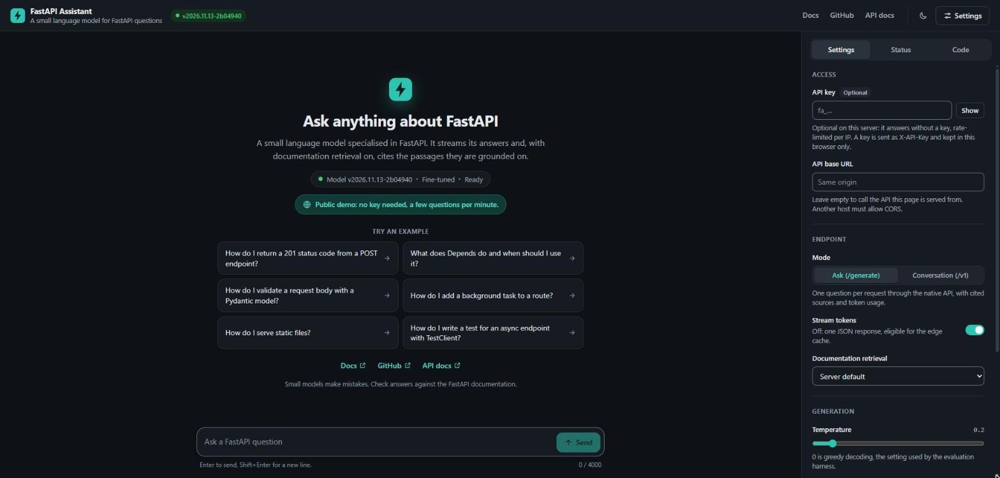
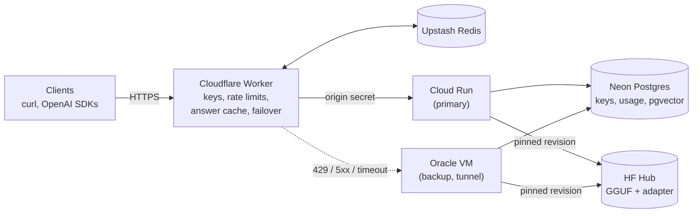
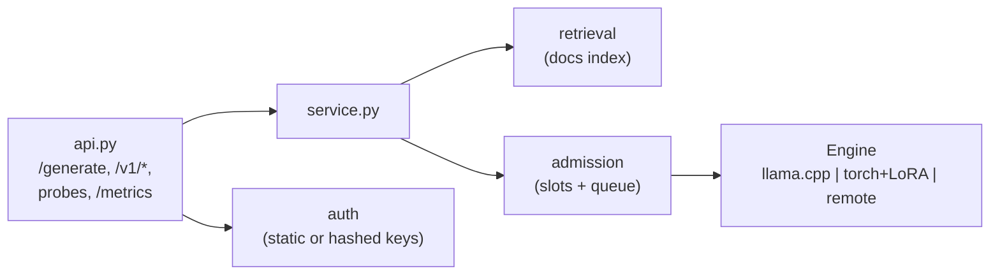
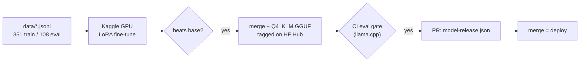

# FastAPI Niche Assistant

A small language model specialised in FastAPI, run as a production service on
free-tier infrastructure: an OpenAI-compatible API with streaming, retrieval over the
official documentation, per-user API keys, back-pressure, an edge layer with
rate limiting, caching and origin failover, and a model-release pipeline in which
**no model ships unless it beats the one it replaces**.

[](https://github.com/syed-waleed-ahmed/Niche-Finetuned-Model/actions/workflows/ci.yml)
[](https://github.com/syed-waleed-ahmed/Niche-Finetuned-Model/actions/workflows/release.yml)
[](https://github.com/syed-waleed-ahmed/Niche-Finetuned-Model/actions/workflows/security.yml)
[](https://github.com/syed-waleed-ahmed/Niche-Finetuned-Model/actions/workflows/codeql.yml)
[](https://github.com/syed-waleed-ahmed/Niche-Finetuned-Model/releases)
[](pyproject.toml)
[](LICENSE)

**[Live demo](https://fastapi-assistant-edge.fastapi-assistant-edge.workers.dev)** (no key needed) ·
**[Documentation](https://syed-waleed-ahmed.github.io/Niche-Finetuned-Model/)** ·
[Examples](examples/) · [Model card](MODEL_CARD.md) ·
[Architecture](docs/architecture/SYSTEM_ARCHITECTURE.md) ·
[Changelog](CHANGELOG.md) · [Roadmap](ROADMAP.md) · [Contributing](CONTRIBUTING.md) ·
[Discussions](https://github.com/syed-waleed-ahmed/Niche-Finetuned-Model/discussions)



> **Status.** The live service runs the *base* TinyLlama-1.1B-Chat model, quantized to
> GGUF (`model-release.json`: `finetuned: false`), and says so in the UI and the API.
> The first fine-tuned model has passed both evaluation gates (0.546 against the base
> model's 0.402 on the held-out set, scored with the production backend) and is
> published on the Hugging Face Hub; it replaces the base model when its release pull
> request is merged. What is live and what is optional is tracked in
> [docs/IMPLEMENTATION_STATUS.md](docs/IMPLEMENTATION_STATUS.md).

## What it does

- **Serves a small model cheaply.** A LoRA fine-tune of TinyLlama-1.1B, merged and
  quantized to a 0.7 GB GGUF and served with llama.cpp on CPU. That is about 13
  tokens/s on a laptop CPU, and 5 to 18 tokens/s per request on a 2-vCPU Cloud Run
  instance, depending on the host. The same `Engine` contract also runs torch + LoRA,
  or forwards to vLLM or TGI for GPU throughput.
- **Speaks two APIs.** A native `POST /generate` and an OpenAI-compatible
  `POST /v1/chat/completions` (streaming included), so the OpenAI SDKs work unchanged.
- **Grounds answers in the docs, when it helps.** Retrieval over 1,534 chunks of the
  FastAPI 0.162.5 documentation (local NumPy index or pgvector), returned as cited
  sources. It is opt-in per request because the eval showed a trade-off (below).
- **Fails predictably under load.** Bounded concurrency and a bounded queue answer
  overload with 429 + `Retry-After` in milliseconds instead of letting requests time
  out; a Cloudflare Worker fails over to the next origin.
- **Treats model quality as a release gate.** A 108-item held-out eval (with required
  API identifiers per answer) scores every candidate with the production backend; the
  deployed weights are pinned in `model-release.json` and roll back with a revert.
- **Is operable.** Prometheus metrics, Grafana dashboard and alerts, JSON logs with
  request ids, Sentry, hashed per-user keys with usage and feedback in Postgres.

## Architecture



Each origin runs the same stateless image:



## Quickstart

Requires Python 3.10-3.12.

```bash
git clone https://github.com/syed-waleed-ahmed/Niche-Finetuned-Model.git
cd Niche-Finetuned-Model
python -m venv .venv && source .venv/bin/activate   # Windows: .venv\Scripts\activate
pip install -e ".[serve]"

# Serve the currently released model (downloads the pinned 0.7 GB GGUF once).
fastapi-assistant export env model-release.json > .env
fastapi-assistant rag build            # optional: docs index for grounded answers
fastapi-assistant serve             # add "use_retrieval": true per request
```

Open http://localhost:8000/docs. With Docker: `docker compose up --build` starts the
service with Postgres + pgvector on port 8080.

To try it in a browser, run the web UI against that server (Node 22+):

```bash
cd web && npm install && npm run dev      # http://localhost:5173, proxies the API
```

For development and training (torch, peft):

```bash
pip install -e ".[dev,train,postgres]"
pytest                                 # 130+ tests; no model, network, or DB needed
fastapi-assistant data validate        # dataset quality + train/eval leakage
fastapi-assistant train                # GPU recommended; see kaggle/ for free GPUs
```

## API

| Method | Path | Description |
| --- | --- | --- |
| `POST` | `/generate` | Answer a question. `stream: true` for Server-Sent Events. |
| `POST` | `/v1/chat/completions` | OpenAI-compatible chat (streaming supported). |
| `GET` | `/v1/models` | OpenAI-compatible model list. |
| `POST` | `/v1/feedback` | Rate an answer (+1/-1) by its request id. |
| `GET` | `/health`, `/ready` | Liveness; readiness (503 until the model is loaded). |
| `GET` | `/metrics` | Prometheus metrics (optionally behind `METRICS_TOKEN`). |

```bash
curl -s localhost:8000/generate -H 'X-API-Key: <key>' -H 'Content-Type: application/json' \
  -d '{"question": "How do I return a 201 from a POST endpoint?", "temperature": 0}'
```

```json
{
  "answer": "Set status_code on the decorator ...",
  "model_version": "base-tinyllama-q4km",
  "finish_reason": "stop",
  "usage": {"prompt_tokens": 560, "completion_tokens": 141, "total_tokens": 701},
  "sources": [{"url": "https://fastapi.tiangolo.com/tutorial/response-status-code/", "heading": "Response Status Code", "score": 0.81}],
  "request_id": "5f0c2a9e1b7d4c3a"
}
```

The OpenAI SDK works as-is:

```python
from openai import OpenAI

client = OpenAI(base_url="http://localhost:8000/v1", api_key="<key>")
for chunk in client.chat.completions.create(
    model="fastapi-assistant",
    messages=[{"role": "user", "content": "What does Depends do?"}],
    stream=True,
):
    print(chunk.choices[0].delta.content or "", end="")
```

Runnable, CI-tested versions of these calls (OpenAI SDK with streaming, native SSE,
curl) are in [examples/](examples/).

Errors are explicit, and `/v1/*` errors use the OpenAI error shape:

| Status | Meaning |
| --- | --- |
| 400 `context_length_exceeded` | The prompt does not fit the model's context window. Prompts are counted in tokens before admission, and `max_tokens` is clamped to the room left. |
| 401 | Missing or invalid API key. |
| 413 | Request body over 64 KiB (`MAX_REQUEST_BYTES`), refused before parsing. |
| 429 with `Retry-After` | Edge rate limit, generation queue full, or the platform scaling out. |
| 503 with `Retry-After` | Model still loading, or the queue wait timed out. |
| 504 | The origin did not answer in time. |

## Web UI

`web/` is a small React + TypeScript playground for the service, served by the edge
Worker as static assets on the same hostname as the API (so no CORS, no extra host,
no cost). It shows what the API does: answers stream token by token, each one with
its documentation sources, model version, token usage, latency and edge cache
status; a 429 or 503 is shown with its `Retry-After` countdown and retried; answers
can be rated (`POST /v1/feedback`). A welcome screen shows the model's status and
example questions. A settings panel holds the API key (browser only), switches
between the native `/generate` API and the OpenAI-compatible multi-turn
`/v1/chat/completions`, and toggles streaming and retrieval. A code panel turns the
current question into copyable curl, Python and JavaScript requests. It has light and
dark themes, works on phones (the panel becomes a drawer), and meets WCAG AA contrast.

```bash
cd web
npm install
npm run dev          # against http://localhost:8000 (see vite.config.ts for the proxy)
npm run typecheck && npm test && npm run build
```

`npm run build` writes `web/dist`, which `deploy/cloudflare-worker/wrangler.toml`
serves via Workers Static Assets. The release workflow builds it before deploying
the Worker. The live deployment runs as a public demo (`PUBLIC_DEMO=true`): visitors
ask without a key, limited per IP at the edge, and the UI says so. With the default
`PUBLIC_DEMO=false`, the UI asks for a key before the first question instead; see
[docs/DEPLOYMENT.md](docs/DEPLOYMENT.md) section 5.

## Evaluation

`fastapi-assistant eval` answers every held-out question with greedy decoding and
scores keyword recall (required API identifiers), code validity (every Python block
parses), and ROUGE-L against a reference. The composite score gates releases.

Measured on the 108-item held-out set with the production backend (Q4_K_M GGUF on
llama.cpp, greedy decoding, 256 new tokens, laptop CPU). This is the bar a fine-tuned
release must clear; `eval/baseline.json` holds the per-item answers.

| Metric | Base TinyLlama (deployed) | Base + retrieval |
| --- | --- | --- |
| Composite score | 0.410 | 0.400 |
| Keyword recall | 0.418 | 0.498 |
| Code validity | 0.538 | 0.401 |
| ROUGE-L | 0.283 | 0.303 |
| Latency p50 (s) | 7.340 | 11.629 |

Retrieval is a trade-off on the base model: keyword recall rises (+0.080) because the
docs name the right APIs, but code validity falls (-0.137) because a 1.1B model copies
code fragments it cannot adapt, so the composite is flat (-0.010) and latency grows by
about 60%. Production therefore keeps retrieval opt-in (`use_retrieval: true`). The
fine-tune trains on context examples in the same layout, and this gate decides
whether retrieval becomes the default.

## Model lifecycle



The two gates:
- **Kaggle:** the fine-tune must beat the base model's composite score by at least 0.005.
- **CI:** the quantized GGUF, run on llama.cpp as in production, must not fall more than
  0.02 below the model it replaces.

Training never reads the held-out eval file. Checkpoints are selected on a validation
slice of the training data.

The dataset is curated: 351 training and 108 eval pairs, with the eval set spanning 41
categories. Every Python block was parsed, and most were executed against FastAPI
during authoring. CI checks for train/eval leakage. `fastapi-assistant data generate`
drafts more pairs from the official docs with Claude, for human review.

## Free-tier deployment

| Layer | Service | In the live deployment |
| --- | --- | --- |
| Edge: auth, rate limit, failover, web UI | Cloudflare Workers | Live, deployed by CI |
| Shared rate limits and answer cache | Upstash Redis | Optional; per-isolate limits apply without it |
| Primary origin | Google Cloud Run (scale to zero, `maxScale` cost cap) | Live, deployed by CI |
| Backup origins | Oracle Cloud Always Free ARM VM (Cloudflare Tunnel), Hugging Face Space | Configuration provided, not deployed |
| Per-user keys, usage, feedback, pgvector | Neon Postgres | Optional; a static key is used without it |
| Training | Kaggle GPU notebooks | Configured |
| Weights | Hugging Face Hub (immutable tags) | Pinned in `model-release.json` |
| Observability | Grafana Cloud (metrics, logs, alerts), Sentry | Optional; Prometheus metrics and JSON logs are built in |
| CI/CD | GitHub Actions + GHCR: tests, Postgres integration, image build and smoke test, Trivy, CodeQL, gitleaks, pip-audit, eval gate, multi-arch release, deploys | Live |

### Capacity

What has been measured is in
[docs/audit/PERFORMANCE_BASELINE.md](docs/audit/PERFORMANCE_BASELINE.md):

- each instance runs one generation at a time;
- a 32-token answer takes about 3 s;
- with `maxScale: 2`, a burst that forces a cold scale-out can see some requests
  refused with 429 and a retry hint.

No supported-user figure is claimed without a load test. Capacity grows by:

- raising `maxScale` (a cost decision);
- adding the backup origins;
- moving inference to a GPU server (`ENGINE_BACKEND=remote`), without changing the API.

Step-by-step setup is in [docs/DEPLOYMENT.md](docs/DEPLOYMENT.md).

## Configuration

All settings are environment variables, validated at startup; `.env.example`
documents every one. The most important:

| Variable | Default | Description |
| --- | --- | --- |
| `ENGINE_BACKEND` | `transformers` | `llamacpp` (production), `transformers`, or `remote`. |
| `GGUF_REPO_ID` / `GGUF_FILENAME` / `GGUF_REVISION` | - | Weights for llama.cpp (set from `model-release.json`). |
| `GGUF_SHA256` | unset | Expected checksum of the GGUF; the load fails closed on a mismatch. |
| `LLAMACPP_N_CTX` | `2048` | Context window; prompts are budgeted against it in tokens. |
| `MAX_REQUEST_BYTES` | `65536` | Largest request body (413 above it; the edge enforces the same cap). |
| `API_KEY` / `DATABASE_URL` | unset | Static key, and/or per-user hashed keys in Postgres. |
| `ORIGIN_SHARED_SECRET` | unset | Reject traffic that did not come through the edge. |
| `MAX_CONCURRENCY` / `MAX_QUEUE` / `QUEUE_TIMEOUT_S` | `1` / `8` / `30` | Back-pressure. |
| `GENERATION_TIMEOUT_S` | `120` | Wall-clock budget per generation. |
| `RAG_ENABLED` / `RAG_BACKEND` | `false` / `local` | Retrieval over the docs (local index or pgvector). |
| `METRICS_TOKEN`, `SENTRY_DSN`, `LOG_JSON` | unset | Observability. |

## Project structure

```text
src/fastapi_assistant/
  api.py, service.py, admission.py   HTTP layer, orchestration, back-pressure
  engines/                           llama.cpp, torch+LoRA, remote (OpenAI-compatible)
  prompts.py                         the one prompt format (train == eval == serve)
  retrieval.py, docs_corpus.py       docs index (local or pgvector) and chunking
  auth.py, storage/                  keys, usage, feedback, SQL migrations
  evaluation.py                      eval harness and release gate
  datasets_tools.py, datagen.py      dataset validation and Claude-assisted drafting
  training.py, export.py, hub.py     fine-tuning, merge/publish, artifact resolution
main.py                              run from a clone without installing (python main.py --serve)
data/                                curated train/eval sets
eval/                                baseline reports the gate compares against
model-release.json                   the deployed model, pinned to Hub revisions
docs/                                architecture, operations, security, audit reports
examples/                            OpenAI SDK, native SSE and curl clients (tested in CI)
web/                                 browser playground (React + Vite), served by the Worker
deploy/                              Cloudflare Worker, Cloud Run, VM, HF Space, Grafana
kaggle/, scripts/                    GPU training pipeline, GGUF export
tests/, tests/load/                  pytest suite, k6 load/smoke scenarios
requirements/serve.txt               hash-pinned lock for the production image (make lock)
Dockerfile, docker-compose.yml       production image; local stack with Postgres + pgvector
graphify-out/                        generated knowledge graph of the codebase (/graphify)
.github/workflows/                   ci, release, security, eval, train, uptime, codeql
```

## Documentation

| Area | Documents |
| --- | --- |
| Website | All of the documents below as a searchable site: [syed-waleed-ahmed.github.io/Niche-Finetuned-Model](https://syed-waleed-ahmed.github.io/Niche-Finetuned-Model/) |
| Architecture | [System](docs/architecture/SYSTEM_ARCHITECTURE.md), [request lifecycle](docs/architecture/REQUEST_LIFECYCLE.md), [deployment](docs/architecture/DEPLOYMENT_ARCHITECTURE.md), [security](docs/architecture/SECURITY_ARCHITECTURE.md), [model pipeline](docs/architecture/MODEL_PIPELINE.md), [decisions](docs/architecture/DECISIONS.md), [overview](docs/ARCHITECTURE.md) |
| Operations | [Deployment](docs/DEPLOYMENT.md), [runbook](docs/operations/RUNBOOK.md), [incident response](docs/operations/INCIDENT_RESPONSE.md), [rollback](docs/operations/ROLLBACK.md), [cost management](docs/operations/COST_MANAGEMENT.md), [backup and recovery](docs/operations/BACKUP_AND_RECOVERY.md) |
| Security | [Security policy](SECURITY.md), [security audit and threat model](docs/security/SECURITY_AUDIT.md), [license audit](docs/legal/LICENSE_AUDIT.md) |
| Audit | [Initial audit](docs/audit/INITIAL_AUDIT.md), [performance baseline](docs/audit/PERFORMANCE_BASELINE.md), [final verification](docs/audit/FINAL_VERIFICATION.md), [implementation status](docs/IMPLEMENTATION_STATUS.md) |
| Project | [Model card](MODEL_CARD.md), [roadmap](ROADMAP.md), [contributing](CONTRIBUTING.md), [code of conduct](CODE_OF_CONDUCT.md), [support](SUPPORT.md), [changelog](CHANGELOG.md), [citation](CITATION.cff), [third-party notices](THIRD_PARTY_NOTICES.md) |

## Development

[](https://codespaces.new/syed-waleed-ahmed/Niche-Finetuned-Model)

The [dev container](.devcontainer/devcontainer.json) installs everything the test
suites need (Python 3.11 with CPU-only torch, Node.js 22, the git hooks), in GitHub
Codespaces or locally with VS Code Dev Containers.

```bash
make test lint          # pytest + ruff + mypy
make worker-test        # Worker typecheck + vitest
make web-test           # web UI typecheck + vitest (make web-dev to run it)
make eval               # score the configured model, gated vs eval/baseline.json
TEST_DATABASE_URL=postgresql://... pytest -m postgres   # Postgres integration tests
```

## Contributing

Contributions are welcome. [CONTRIBUTING.md](CONTRIBUTING.md) covers:
- the development setup;
- the checks a pull request must pass;
- the rules for the evaluation data (never edit the held-out set or the baselines to
  improve a score);
- how to propose a model release.

New here? Issues labelled
[good first issue](https://github.com/syed-waleed-ahmed/Niche-Finetuned-Model/labels/good%20first%20issue)
are small and self-contained, and the [roadmap](ROADMAP.md) shows where the project is
heading. Questions and ideas go to
[Discussions](https://github.com/syed-waleed-ahmed/Niche-Finetuned-Model/discussions).

Everyone taking part agrees to the [Code of Conduct](CODE_OF_CONDUCT.md).

## Security

Please report vulnerabilities privately through
[GitHub private vulnerability reporting](https://github.com/syed-waleed-ahmed/Niche-Finetuned-Model/security/advisories/new),
not in public issues. See [SECURITY.md](SECURITY.md) for scope and response targets,
and [the security audit](docs/security/SECURITY_AUDIT.md) for the threat model.

## Citation

If you use this project in your work, cite it with the metadata in
[CITATION.cff](CITATION.cff). GitHub shows a "Cite this repository" button for it.

## Acknowledgements

This project builds on:
- [TinyLlama](https://huggingface.co/TinyLlama/TinyLlama-1.1B-Chat-v1.0) (Apache-2.0);
- [llama.cpp](https://github.com/ggml-org/llama.cpp) (MIT);
- the [FastAPI documentation](https://github.com/fastapi/fastapi) (MIT), which grounds
  retrieval;
- [bge-small-en-v1.5](https://huggingface.co/BAAI/bge-small-en-v1.5) (MIT), for
  embeddings.

[THIRD_PARTY_NOTICES.md](THIRD_PARTY_NOTICES.md) and
[the license audit](docs/legal/LICENSE_AUDIT.md) list every third-party component and
its license.

## License

The code is released under the [MIT License](LICENSE). Copyright (c) 2026 Syed Waleed
Ahmed.

Model weights derived from TinyLlama are distributed under the Apache License 2.0;
see [MODEL_CARD.md](MODEL_CARD.md).
