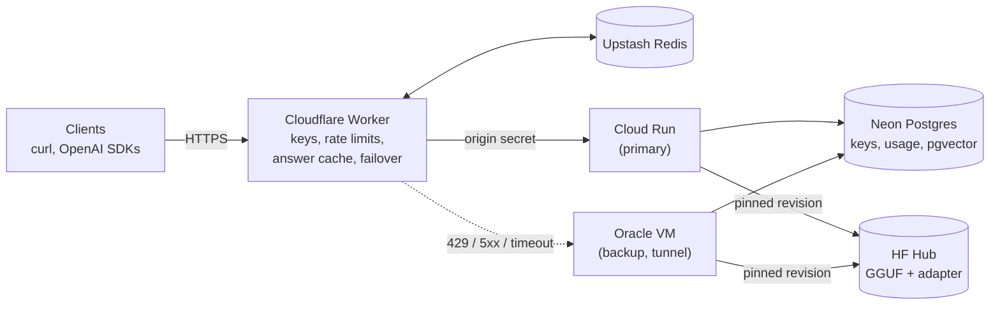
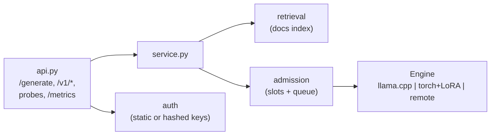
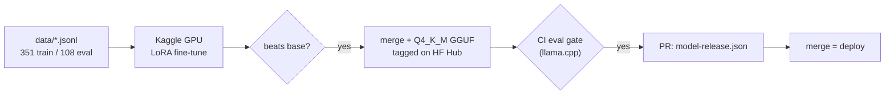

# FastAPI Niche Assistant

A fine-tuned small language model that answers FastAPI questions, run as a
production service on free-tier infrastructure: an OpenAI-compatible API,
streaming, retrieval over the official docs, per-user API keys, back-pressure,
an edge cache with multi-origin failover, and a model-release pipeline where
**no model ships unless it beats the one it replaces**.


See [ARCHITECTURE.md](ARCHITECTURE.md) for the high-level design and
[docs/DEPLOYMENT.md](docs/DEPLOYMENT.md) for the deployment runbook.

## What it does

- **Serves a fine-tuned model cheaply.** LoRA fine-tune of TinyLlama-1.1B, merged and
  quantized to a 0.7 GB GGUF and served with llama.cpp on CPU (about 13 tokens/s on
  a laptop CPU). The same `Engine` contract also runs torch + LoRA, or forwards to
  vLLM/TGI for GPU throughput.
- **Speaks two APIs.** A native `POST /generate` and an OpenAI-compatible
  `POST /v1/chat/completions` (streaming included), so the OpenAI SDKs work unchanged.
- **Grounds answers in the docs, when it helps.** Retrieval over 1,534 chunks of the
  FastAPI 0.162.5 documentation (local NumPy index or pgvector), returned as cited
  sources. It is opt-in per request because the eval showed a trade-off (below).
- **Fails predictably under load.** Bounded concurrency and a bounded queue answer
  overload with 429 + `Retry-After` in milliseconds instead of letting requests time
  out; a Cloudflare Worker fails over to the next origin.
- **Treats model quality as a release gate.** A 108-item held-out eval (with required
  API identifiers per answer) scores every candidate with the production backend; the
  deployed weights are pinned in `model-release.json` and roll back with a revert.
- **Is operable.** Prometheus metrics, Grafana dashboard and alerts, JSON logs with
  request ids, Sentry, hashed per-user keys with usage and feedback in Postgres.

## Architecture



Each origin runs the same stateless image:



## Quickstart

Requires Python 3.10-3.12.

```bash
git clone https://github.com/syed-waleed-ahmed/Niche-Finetuned-Model.git
cd Niche-Finetuned-Model
python -m venv .venv && source .venv/bin/activate   # Windows: .venv\Scripts\activate
pip install -e ".[serve]"

# Serve the currently released model (downloads the pinned 0.7 GB GGUF once).
fastapi-assistant export env model-release.json > .env
fastapi-assistant rag build            # optional: docs index for grounded answers
fastapi-assistant serve             # add "use_retrieval": true per request
```

Open http://localhost:8000/docs. With Docker: `docker compose up --build` starts the
service with Postgres + pgvector on port 8080.

To try it in a browser, run the web UI against that server (Node 22+):

```bash
cd web && npm install && npm run dev      # http://localhost:5173, proxies the API
```

For development and training (torch, peft):

```bash
pip install -e ".[dev,train,postgres]"
pytest                                 # about 90 tests; no model, network, or DB needed
fastapi-assistant data validate        # dataset quality + train/eval leakage
fastapi-assistant train                # GPU recommended; see kaggle/ for free GPUs
```

## API

| Method | Path | Description |
| --- | --- | --- |
| `POST` | `/generate` | Answer a question. `stream: true` for Server-Sent Events. |
| `POST` | `/v1/chat/completions` | OpenAI-compatible chat (streaming supported). |
| `GET` | `/v1/models` | OpenAI-compatible model list. |
| `POST` | `/v1/feedback` | Rate an answer (+1/-1) by its request id. |
| `GET` | `/health`, `/ready` | Liveness; readiness (503 until the model is loaded). |
| `GET` | `/metrics` | Prometheus metrics (optionally behind `METRICS_TOKEN`). |

```bash
curl -s localhost:8000/generate -H 'X-API-Key: <key>' -H 'Content-Type: application/json' \
  -d '{"question": "How do I return a 201 from a POST endpoint?", "temperature": 0}'
```

```json
{
  "answer": "Set status_code on the decorator ...",
  "model_version": "base-tinyllama-q4km",
  "finish_reason": "stop",
  "usage": {"prompt_tokens": 560, "completion_tokens": 141, "total_tokens": 701},
  "sources": [{"url": "https://fastapi.tiangolo.com/tutorial/response-status-code/", "heading": "Response Status Code", "score": 0.81}],
  "request_id": "5f0c2a9e1b7d4c3a"
}
```

The OpenAI SDK works as-is:

```python
from openai import OpenAI

client = OpenAI(base_url="http://localhost:8000/v1", api_key="<key>")
for chunk in client.chat.completions.create(
    model="fastapi-assistant",
    messages=[{"role": "user", "content": "What does Depends do?"}],
    stream=True,
):
    print(chunk.choices[0].delta.content or "", end="")
```

Errors are explicit: 401 (missing/invalid key), 429 with `Retry-After` (capacity),
503 with `Retry-After` (model loading or queue timeout). `/v1/*` errors use the
OpenAI error shape.

## Web UI

`web/` is a small React + TypeScript playground for the service, served by the edge
Worker as static assets on the same hostname as the API (so no CORS, no extra host,
no cost). It shows what the API does: answers stream token by token, each one with
its documentation sources, model version, token usage, latency and edge cache
status; a 429 or 503 is shown with its `Retry-After` countdown and retried; answers
can be rated (`POST /v1/feedback`). A settings panel holds the API key (browser
only), switches between the native `/generate` API and the OpenAI-compatible
multi-turn `/v1/chat/completions`, and toggles streaming and retrieval. A code panel
turns the current question into copyable curl, Python and JavaScript requests.

```bash
cd web
npm install
npm run dev          # against http://localhost:8000 (see vite.config.ts for the proxy)
npm run typecheck && npm test && npm run build
```

`npm run build` writes `web/dist`, which `deploy/cloudflare-worker/wrangler.toml`
serves via Workers Static Assets. The release workflow builds it before deploying
the Worker. A public demo needs either a dedicated key (`fastapi-assistant keys
create demo`) that visitors paste into Settings, or `REQUIRE_API_KEY=false` on the
Worker and no `API_KEY`/`DATABASE_URL` on the origins, in which case per-IP rate
limits apply.

## Evaluation

`fastapi-assistant eval` answers every held-out question with greedy decoding and
scores keyword recall (required API identifiers), code validity (every Python block
parses), and ROUGE-L against a reference. The composite score gates releases.

Measured on the 108-item held-out set with the production backend (Q4_K_M GGUF on
llama.cpp, greedy decoding, 256 new tokens, laptop CPU). This is the bar a fine-tuned
release must clear; `eval/baseline.json` holds the per-item answers.

| Metric | Base TinyLlama (deployed) | Base + retrieval |
| --- | --- | --- |
| Composite score | 0.410 | 0.400 |
| Keyword recall | 0.418 | 0.498 |
| Code validity | 0.538 | 0.401 |
| ROUGE-L | 0.283 | 0.303 |
| Latency p50 (s) | 7.340 | 11.629 |

Retrieval is a trade-off on the base model: keyword recall rises (+0.080) because the
docs name the right APIs, but code validity falls (-0.137) because a 1.1B model copies
code fragments it cannot adapt, so the composite is flat (-0.010) and latency grows by
about 60%. Production therefore keeps retrieval opt-in (`use_retrieval: true`). The
fine-tune trains on context examples in the same layout, and this gate decides
whether retrieval becomes the default.

## Model lifecycle



The dataset is curated: 351 training and 108 eval pairs across 42 topics, every
Python block parsed and most executed against FastAPI during authoring. Train/eval
leakage is checked in CI. `fastapi-assistant data generate` drafts more pairs from
the official docs with Claude for human review.

## Free-tier deployment

| Layer | Service |
| --- | --- |
| Edge, auth, rate limit, cache | Cloudflare Workers + Upstash Redis |
| Primary origin | Google Cloud Run (scale to zero, `maxScale` cost cap) |
| Backup origins | Oracle Cloud Always Free ARM VM (Cloudflare Tunnel), Hugging Face Space |
| Database | Neon Postgres (+ pgvector) |
| Training | Kaggle GPU notebooks |
| Weights | Hugging Face Hub (immutable tags) |
| Observability | Grafana Cloud (metrics, logs, alerts), Sentry |
| CI/CD | GitHub Actions + GHCR: tests, Postgres integration, image build, smoke test, Trivy, CodeQL, gitleaks, eval gate, multi-arch release, deploys |

Free tiers support roughly hundreds to a few thousand uncached answers per day; the
architecture scales past that by raising limits or moving inference to a GPU server
(`ENGINE_BACKEND=remote`) without changing the API. Step-by-step setup is in
[docs/DEPLOYMENT.md](docs/DEPLOYMENT.md).

## Configuration

All settings are environment variables, validated at startup; `.env.example`
documents every one. The most important:

| Variable | Default | Description |
| --- | --- | --- |
| `ENGINE_BACKEND` | `transformers` | `llamacpp` (production), `transformers`, or `remote`. |
| `GGUF_REPO_ID` / `GGUF_FILENAME` / `GGUF_REVISION` | - | Weights for llama.cpp (set from `model-release.json`). |
| `API_KEY` / `DATABASE_URL` | unset | Static key, and/or per-user hashed keys in Postgres. |
| `ORIGIN_SHARED_SECRET` | unset | Reject traffic that did not come through the edge. |
| `MAX_CONCURRENCY` / `MAX_QUEUE` / `QUEUE_TIMEOUT_S` | `1` / `8` / `30` | Back-pressure. |
| `GENERATION_TIMEOUT_S` | `120` | Wall-clock budget per generation. |
| `RAG_ENABLED` / `RAG_BACKEND` | `false` / `local` | Retrieval over the docs (local index or pgvector). |
| `METRICS_TOKEN`, `SENTRY_DSN`, `LOG_JSON` | unset | Observability. |

## Project structure

```text
src/fastapi_assistant/
  api.py, service.py, admission.py   HTTP layer, orchestration, back-pressure
  engines/                           llama.cpp, torch+LoRA, remote (OpenAI-compatible)
  prompts.py                         the one prompt format (train == eval == serve)
  retrieval.py, docs_corpus.py       docs index (local or pgvector) and chunking
  auth.py, storage/                  keys, usage, feedback, SQL migrations
  evaluation.py                      eval harness and release gate
  datasets_tools.py, datagen.py      dataset validation and Claude-assisted drafting
  training.py, export.py, hub.py     fine-tuning, merge/publish, artifact resolution
data/                                curated train/eval sets
eval/                                baseline reports the gate compares against
model-release.json                   the deployed model, pinned to Hub revisions
web/                                 browser playground (React + Vite), served by the Worker
deploy/                              Cloudflare Worker, Cloud Run, VM, HF Space, Grafana
kaggle/, scripts/                    GPU training pipeline, GGUF export
loadtest/                            k6 scenarios
.github/workflows/                   ci, release, eval, train, uptime, codeql
```

## Development

```bash
make test lint          # pytest + ruff
make worker-test        # Worker typecheck + vitest
make web-test           # web UI typecheck + vitest (make web-dev to run it)
make eval               # score the configured model, gated vs eval/baseline.json
TEST_DATABASE_URL=postgresql://... pytest -m postgres   # Postgres integration tests
```

## License

[MIT](LICENSE). Copyright (c) 2026 Syed Waleed Ahmed.
