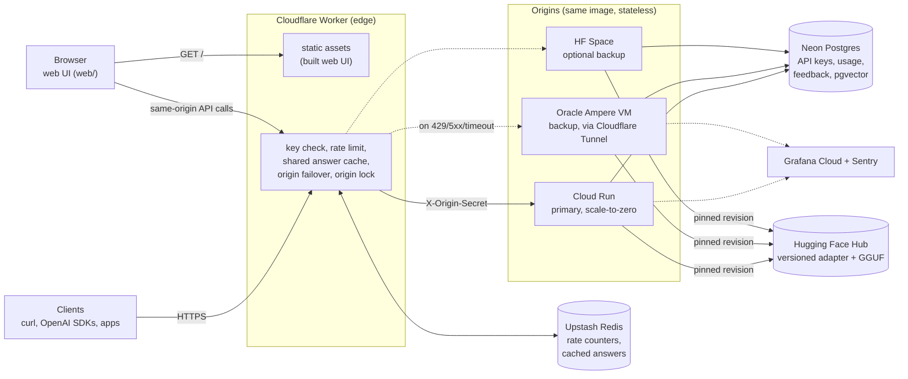
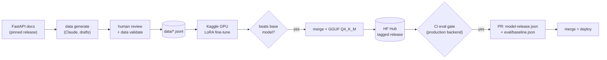
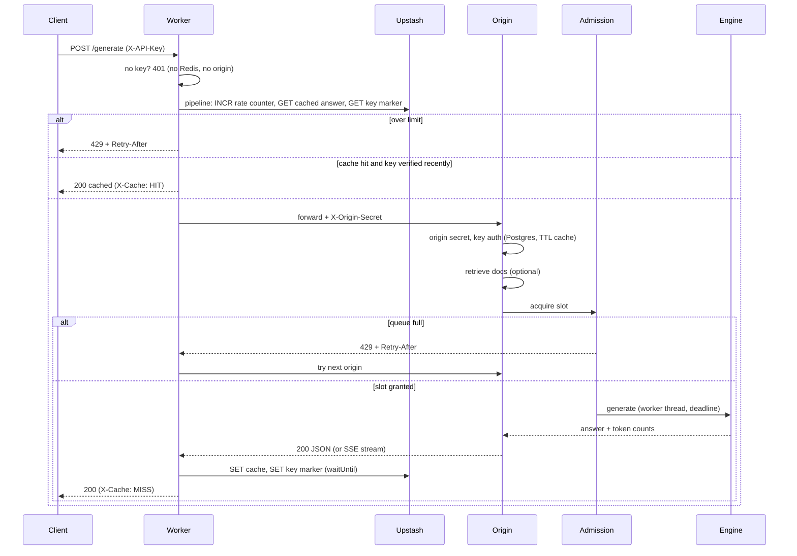

# Architecture (High-Level Design)

This document describes the FastAPI Assistant as a production system: a small
fine-tuned language model served behind an edge layer, across several free-tier
origins, with a gated model-release pipeline. It is written for an HLD review: it
states responsibilities, data flow, the scaling and failure model, and the
trade-offs behind each decision.

Detailed companion documents live in [architecture/](architecture/):
[system](architecture/SYSTEM_ARCHITECTURE.md),
[request lifecycle](architecture/REQUEST_LIFECYCLE.md),
[deployment](architecture/DEPLOYMENT_ARCHITECTURE.md),
[security](architecture/SECURITY_ARCHITECTURE.md),
[model pipeline](architecture/MODEL_PIPELINE.md) and
[decision records](architecture/DECISIONS.md). What is live today, as opposed to
designed, is in [IMPLEMENTATION_STATUS.md](IMPLEMENTATION_STATUS.md).

## 1. Goals and non-goals

**Goals**

- Answer FastAPI questions with a fine-tuned small model behind a stable HTTP API
  (native and OpenAI-compatible).
- Run at zero cost on free tiers, while keeping the architecture that scales by
  adding capacity rather than by redesign.
- Make model quality a release gate: no model ships unless it beats the one it
  replaces on a held-out evaluation.
- Degrade gracefully: overload produces fast, explicit back-pressure (429 +
  `Retry-After`), not timeouts; a failed origin is routed around.

**Non-goals**

- High-throughput multi-tenant inference on free hardware. One CPU replica
  produces roughly 8-15 tokens/s (8-10 measured on a 2-vCPU Cloud Run instance; see
  [audit/PERFORMANCE_BASELINE.md](audit/PERFORMANCE_BASELINE.md)); capacity grows with replicas or a GPU server
  (section 8), not inside this process.
- General-purpose chat. The service answers FastAPI questions with one system
  prompt.

## 2. System overview

Model build pipeline (offline):

## 3. Components

| Component | Responsibility |
| --- | --- |
| `deploy/cloudflare-worker` | Edge: API-key presence check, per-key and per-IP rate limits, shared answer cache, ordered origin failover, injects `X-Origin-Secret`. Also serves the built web UI as static assets. |
| `web/` | Browser playground (React + TypeScript, no server): streaming answers with sources, usage and edge headers, `Retry-After` handling, feedback, both APIs, copyable client snippets. Same hostname as the API, so there is no CORS surface and no extra host. |
| `api.py` | App factory, routes (`/generate`, `/v1/chat/completions`, `/v1/models`, `/v1/feedback`, probes, `/metrics`), middleware (request id, origin lock, access log, metrics), error mapping. |
| `service.py` | One code path for both APIs: retrieval, admission, generation, metrics, usage accounting. |
| `admission.py` | Bounded concurrency plus bounded wait queue; rejects with `Retry-After`. |
| `engines/` | `Engine` contract with three backends: `transformers` (torch + LoRA), `llamacpp` (GGUF on CPU, production), `remote` (OpenAI-compatible server such as vLLM). |
| `prompts.py` | The single definition of the prompt format, shared by training, evaluation, and serving. |
| `retrieval.py`, `docs_corpus.py` | Documentation index (local NumPy or pgvector) and the docs loader/chunker. |
| `auth.py`, `storage/` | Static key or per-user hashed keys in Postgres (TTL-cached), usage events, feedback, SQL migrations. |
| `evaluation.py` | Eval harness and release gate. |
| `datasets_tools.py`, `datagen.py` | Dataset validation (including train/eval leakage) and Claude-assisted drafting from the docs. |
| `training.py`, `export.py`, `kaggle/`, `scripts/export_gguf.sh` | Fine-tuning, merging, GGUF conversion, Hub publishing, release manifest. |

The most important invariant: **the prompt format lives in `prompts.py` only.**
Training, evaluation, and serving all call `build_messages` / `normalize_chat`, and
the GGUF converter embeds the same tokenizer chat template. If any of them diverged,
quality would silently collapse.

## 4. Request lifecycle

Streaming responses (`stream: true`) bypass the cache and are passed through
unbuffered. If the client disconnects mid-stream, a cancellation event stops the
engine at the next token and the slot is released.

## 5. Back-pressure and concurrency

- An origin runs at most `MAX_CONCURRENCY` generations (1 on CPU) and lets at most
  `MAX_QUEUE` more wait, each for at most `QUEUE_TIMEOUT_S`. Anything beyond is
  rejected immediately with 429 and a `Retry-After` estimated from the moving
  average service time.
- Overload is therefore visible (metric `assistant_admission_rejections_total`),
  cheap (no work done), and actionable: the edge retries the next origin, and
  clients back off.
- Each generation has a wall-clock budget (`GENERATION_TIMEOUT_S`) enforced inside
  the decode loop (`finish_reason: "timeout"`), so one long request cannot hold a
  slot indefinitely.
- Model loading is load-once under a lock and runs in the background at startup.
  `/ready` is non-blocking: 503 until loaded, so platform probes never time out
  while weights download.

## 6. Caching and its safety rule

The edge caches non-streaming answers in Redis for `CACHE_TTL_SECONDS`, keyed by
`MODEL_VERSION` and the canonical request body, and shared across users (answers do
not depend on the caller). A shared cache must not become an authentication bypass,
so a hit is served only to a key the origin accepted within the last
`KEY_VERIFIED_TTL_SECONDS`. Unknown keys always reach the origin. Releasing a new
model changes `MODEL_VERSION`, which moves the cache namespace.

## 7. Data model (Postgres)

| Table | Purpose |
| --- | --- |
| `api_keys` | `key_hash` (SHA-256, unique), display prefix, active flag. Plaintext keys are shown once and never stored. |
| `usage_events` | Per request: key, endpoint, status, prompt/completion tokens, latency, finish reason, model version. Question/answer text only if `STORE_TRANSCRIPTS=true`. |
| `feedback` | Rating (+1/-1) and comment, joined to usage by request id: the raw material for the next dataset iteration. |
| `doc_chunks` | Documentation chunks with `vector(384)` embeddings and an HNSW cosine index (pgvector backend). |

Migrations are ordered SQL files applied by `fastapi-assistant db migrate`.

## 8. Scaling path

The origins are stateless (the only in-memory state is the read-only model and
short-lived auth cache), so capacity scales by replication. In order of cost:

1. **Cache** (free): repeated questions never reach a model.
2. **More free origins**: Cloud Run instances (`maxScale`), the Oracle VM, a Space.
   The edge fails over on 429/5xx/timeouts, so replicas absorb each other's load.
3. **Paid CPU capacity**: raise `maxScale`; no code change.
4. **GPU inference server**: run vLLM or TGI with the merged model and set
   `ENGINE_BACKEND=remote`. Continuous batching raises throughput by orders of
   magnitude; the service keeps auth, admission, metrics, and the API contract.
5. **Bigger base model**: the training pipeline is base-model agnostic
   (`BASE_MODEL_NAME`); the eval gate decides whether it ships.

## 9. Model lifecycle and release gates

1. Data: hand-written and Claude-drafted pairs from the pinned docs, reviewed, then
   `data validate` (schema, parseable code, duplicates, eval leakage) in CI.
2. Train on a free Kaggle GPU (`train.yml` -> `kaggle/pipeline.py`).
3. Gate 1 (Kaggle): the fine-tune must beat the base model on the eval set.
4. Export: merge, convert, quantize to Q4_K_M, push adapter and GGUF to the Hub
   under an immutable tag.
5. Gate 2 (CI, `eval.yml`): score the GGUF with the production backend; it must not
   regress more than 0.02 against the model on `main`.
6. Release: a PR updates `model-release.json` (pinned revisions) and
   `eval/baseline.json`. Merging deploys; reverting rolls back.

## 10. Observability

- Metrics (`/metrics`, Prometheus): request rate/latency by route template,
  generation latency, tokens/s, prompt/completion tokens, finish reasons, queue
  depth, in-flight, admission rejections, retrieval latency, model loaded, build
  info. Scraped by Alloy on the VM, and by Grafana Cloud's metrics endpoint job for
  Cloud Run. Dashboard and alert rules live in `deploy/grafana/`.
- Logs: one JSON line per request with request id, status, and duration; the Worker
  logs cache status, origin, attempts, and rate-limit identity type (never keys).
- Errors: Sentry (optional), with release `fastapi-assistant@<version>+<model>`.
- Uptime: a 10-minute synthetic probe through the edge (`uptime.yml`).

## 11. Security

- Edge rejects missing keys; origins validate keys (hashed, constant-time static
  comparison) and reject requests without the shared origin secret.
- CORS never allows credentials; auth is header-based.
- Secrets live in Secret Manager / Worker secrets / GitHub secrets; CI deploys
  through Workload Identity Federation (no long-lived cloud keys). Third-party
  Actions are pinned to commit SHAs.
- Images: non-root user, no compiler or packaging tools, Debian security updates
  applied, hash-pinned dependencies, Trivy scan (fails on fixable high and critical
  CVEs), CodeQL, gitleaks, pip-audit, npm audit, dependency review, Dependabot.
- Generated code is only executed by the evaluator when explicitly enabled
  (`--execute-code`), and only in disposable environments.

## 12. Failure modes

| Failure | Behavior |
| --- | --- |
| Origin overloaded | 429 + `Retry-After`; edge tries the next origin. |
| Origin down or slow | Edge times out (`ORIGIN_TIMEOUT_MS`) and fails over; 502 if every origin fails. |
| Model not loaded yet | `/ready` 503 (platform holds traffic); requests get 503 + `Retry-After`. |
| Weights download fails | Load state `failed`; retried on the next `/ready` or request. |
| Postgres unavailable | Static-key requests keep working; per-user keys fail closed (401/500); usage writes are logged and dropped. |
| Retrieval fails | Answer without context; logged and counted. |
| Redis unavailable or not configured | No shared cache; rate limiting falls back to per-isolate in-memory counters (weaker, never off); traffic still flows. |
| Generation exceeds budget | Truncated with `finish_reason: "timeout"`. |
| Bad model release | Blocked by the eval gates; otherwise revert `model-release.json`. |

## 13. Decision log

- **llama.cpp GGUF for production, torch for training.** Q4_K_M is about 0.7 GB and
  several times faster than fp32 torch on CPU, which is what makes free CPU
  instances usable. torch remains the reference backend for training-time eval.
- **Admission control over unbounded queuing.** Fast 429s keep latency honest and
  let the edge spread load; unbounded queues only move the timeout elsewhere.
- **Shared edge cache with a verified-key rule.** Maximizes hit rate across users
  without letting cache hits bypass authentication.
- **Release manifest in git.** Deployed weights are a reviewed, revertable change
  pinned to immutable Hub tags, not "latest".
- **Eval gate on the production backend.** Quantization changes outputs; gating the
  fp16 adapter alone would not catch a bad GGUF.
- **OpenAI-compatible API.** Existing SDKs and tools work unchanged, and the same
  contract fronts a future vLLM backend.
- **Retrieval through the training `context` slot, opt-in by default.** RAG uses the
  exact layout the model saw for context examples, and its effect is measured by
  `eval --rag`, not assumed. On the base model it raised keyword recall (+0.08) but
  lowered code validity (-0.14) and added about 60% latency, so it ships opt-in per
  request until a release shows a net gain.
- **App factory with injected engine/store/retriever.** The full HTTP surface is
  tested without a model, database, or network.
