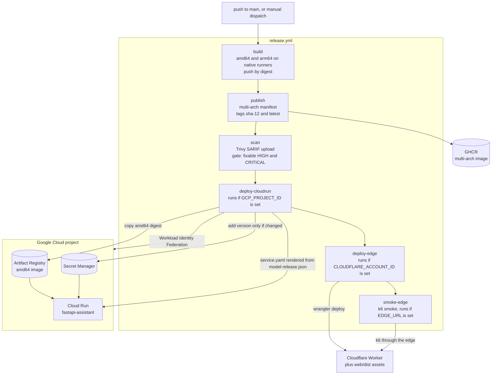

# Deployment architecture

What runs where, how a commit on `main` becomes a running revision, and which parts
are configured but not deployed. Step-by-step setup lives in
[docs/DEPLOYMENT.md](../DEPLOYMENT.md); this document describes the result.

## 1. Live versus configured

Status as recorded on 2026-11-13 in
[docs/audit/INITIAL_AUDIT.md](../audit/INITIAL_AUDIT.md),
[docs/audit/FINAL_VERIFICATION.md](../audit/FINAL_VERIFICATION.md) and
[docs/IMPLEMENTATION_STATUS.md](../IMPLEMENTATION_STATUS.md).

This document set describes the code on `main`. The hardening changes (PR #13) and
the follow-ups #14 to #16 are merged and deployed: behaviour such as the fallback rate
limiter, the body caps, the token budget and GGUF verification is live. Release
deploys both Cloud Run and the Worker from `main`.

| Component | Status | Evidence |
| --- | --- | --- |
| Edge Worker `fastapi-assistant-edge` with the web UI, at https://fastapi-assistant-edge.fastapi-assistant-edge.workers.dev | Live. Deployed by Release (`deploy-edge`) from `main`. | Release run 43460008003; F-10 (resolved) |
| Cloud Run service `fastapi-assistant` | Live, deployed by Release from `main` | Audit header; `.github/workflows/release.yml` |
| Model | The fine-tuned release `v2026.11.13-2b04940`: a LoRA fine-tune of TinyLlama-1.1B-Chat as a Q4_K_M GGUF | `model-release.json` (`"finetuned": true`); F-04 (resolved in #33) |
| Authentication | Static owner key from Secret Manager; origin locked to the edge | Implementation status |
| Secret Manager, Artifact Registry, Workload Identity Federation, budget alert | Live | Audit section 5; `deploy/gcp/bootstrap.sh` |
| Upstash Redis (shared rate limit and cache) | Not configured, so the answer cache is off and rate limiting runs per isolate (the fallback limiter). | F-03; implementation status |
| Neon Postgres (per-user keys, usage, feedback) | Not configured | Implementation status |
| Sentry, Grafana Cloud | Not connected | Implementation status |
| `uptime.yml` | Live: `EDGE_URL` is set | Implementation status |
| Release jobs `deploy-edge`, `smoke-edge` | Live: `CLOUDFLARE_API_TOKEN` and `CLOUDFLARE_ACCOUNT_ID` are set. Both jobs succeeded in Release run 43460008003 (the merge of #15). | F-10 (resolved); `release.yml` |
| Backup origins: Hugging Face Space, Oracle VM | Configuration only, not deployed. `ORIGINS` lists Cloud Run only. | F-11; `deploy/hf-space/`, `deploy/vm/` |
| Train on Kaggle | Configured: the Kaggle API token and username, `HF_NAMESPACE`, and `HF_TOKEN` attached to the kernel on Kaggle. The first runs exposed Kaggle environment problems, fixed in #15 and #16. A later run trained `v2026.11.13-2b04940`, which is deployed (#33). | F-04; `.github/workflows/train.yml` |

## 2. Delivery pipeline

All the jobs below run on every Release today. A deploy job is skipped only when its
platform variable is not set (section 3).

Since #15, `deploy-edge` and `smoke-edge` run on every Release (first success: run
43460008003).

## 3. Release workflow stages

`.github/workflows/release.yml` runs on every push to `main` (skipped when every
changed file is Markdown or under `docs/`, `graphify-out/`, `eval/` or `tests/load/`)
and on manual dispatch. Runs never overlap (`concurrency: release`, not cancelled).

| Job | Runs when | What it does | Gate |
| --- | --- | --- | --- |
| `build` | Always | Builds `linux/amd64` on `ubuntu-24.04` and `linux/arm64` on `ubuntu-24.04-arm` from the same `Dockerfile`; pushes each by digest to GHCR. | Build must succeed |
| `publish` | After `build` | Creates one multi-arch manifest tagged `sha-<12 chars>` and `latest`. | |
| `scan` | After `publish` | Trivy scans the published image twice: once to upload SARIF to code scanning, once with `exit-code: 1` on fixable `CRITICAL,HIGH` (`ignore-unfixed: true`). `/models/rag_index` is skipped because the baked documentation contains an example JWT (F-21). | Fails the release on a fixable HIGH or CRITICAL CVE |
| `deploy-cloudrun` | `vars.GCP_PROJECT_ID` set; after `scan` | Authenticates with Workload Identity Federation (no key file). Copies the amd64 image into Artifact Registry. Syncs five secrets into Secret Manager. Renders `deploy/cloudrun/service.yaml` with `envsubst` from repository variables and `fastapi-assistant export env model-release.json`. Deploys, grants `allUsers` the invoker role, then polls `/health` and `/ready` on the new URL. | Smoke: `/ready` must answer 200 |
| `deploy-edge` | `vars.CLOUDFLARE_ACCOUNT_ID` set; not after a failure | Builds `web/` and runs `wrangler deploy` with `MODEL_VERSION` from `model-release.json` (the cache namespace) and `ORIGINS` from `vars.EDGE_ORIGINS`. Uploads the Worker secret `ORIGIN_SHARED_SECRET`, plus `UPSTASH_REDIS_REST_URL` and `UPSTASH_REDIS_REST_TOKEN` only when both GitHub secrets are set (#15). Authenticates with `secrets.CLOUDFLARE_API_TOKEN`; the job condition checks only the account ID variable, so the token must exist too or `wrangler` fails. | |
| `smoke-edge` | `vars.EDGE_URL` set and `deploy-edge` succeeded | `k6 run -e SCENARIO=smoke tests/load/k6.js` through the edge. | k6 thresholds |

Both deploy jobs use the `production` GitHub environment.

### Secrets flow

GitHub encrypted secrets are the source of truth; they are created by
`scripts/setup_secrets.sh` and never printed (except the operator's own API key,
once). `deploy-cloudrun` copies them into Secret Manager, adding a version only when
the value changed. Cloud Run reads them as environment variables.

| Secret Manager name | Environment variable | Required |
| --- | --- | --- |
| `origin-shared-secret` | `ORIGIN_SHARED_SECRET` | Yes. The sync fails if the GitHub secret is missing. |
| `api-key` | `API_KEY` | Yes |
| `metrics-token` | `METRICS_TOKEN` | Yes |
| `database-url` | `DATABASE_URL` | No. `disabled` placeholder, treated as unset by `config.py`. |
| `sentry-dsn` | `SENTRY_DSN` | No. `disabled` placeholder. |

`deploy/gcp/bootstrap.sh` grants the deployer service account `roles/run.admin`,
`roles/artifactregistry.writer` and `roles/secretmanager.admin`, and the runtime
service account only `roles/secretmanager.secretAccessor`. The Workload Identity
provider accepts tokens only from this repository's `refs/heads/main`.

## 4. Cloud Run service

Values from `deploy/cloudrun/service.yaml` after rendering.

| Setting | Value | Why |
| --- | --- | --- |
| `minScale` | 0 | Scale to zero when idle |
| `maxScale` | `CLOUD_RUN_MAX_INSTANCES`, default 2 | The only hard spending limit; the budget alert only notifies |
| `cpu-throttling` | `true` | Request-based billing: CPU billed only while serving requests |
| `startup-cpu-boost` | `true` | Faster cold start (model load) |
| Execution environment | `gen2` | |
| CPU, memory | 2 vCPU, 2 GiB | Fits the 0.7 GB GGUF; `LLAMACPP_N_THREADS=2` |
| `containerConcurrency` | 4 | Sized to one running generation plus `MAX_QUEUE=3` waiting (comment in the file) |
| Container port | `h2c` (8080) | Cloud Run talks cleartext HTTP/2 to the container, which is how it reports a client's disconnect. The image serves it with Hypercorn (`HTTP_SERVER=hypercorn`); see [DECISIONS.md](DECISIONS.md), ADR-009 |
| `timeoutSeconds` | 300 | Whole request, including a stream |
| `MAX_CONCURRENCY`, `MAX_QUEUE`, `QUEUE_TIMEOUT_S` | 1, 3, 60 | Admission control (`admission.py`) |
| `RAG_ENABLED` | `false` | Retrieval opt-in per request |
| Startup probe | `GET /ready` every 5 s, timeout 3 s, 48 failures allowed | Up to 240 s for download, SHA-256 check and load |
| Liveness probe | `GET /health` every 30 s, timeout 5 s | |
| Ingress | `all`, with `allUsers` as invoker | The origin secret, not IAM, blocks direct use (403) |
| Template label | `model-version` | Each revision is labelled with the release it serves |

Model environment (`MODEL_VERSION`, `GGUF_REPO_ID`, `GGUF_FILENAME`, `GGUF_REVISION`,
`GGUF_SHA256`, `FINETUNED_WEIGHTS`, `LLAMACPP_CHAT_FORMAT`) comes from
`model-release.json` through `export.manifest_env`.

## 5. Container image

`Dockerfile`, two stages:

| Stage | Content |
| --- | --- |
| `builder` (`python:3.11-slim`) | `build-essential` and `cmake`; `pip wheel --require-hashes -r requirements/serve.txt`; llama.cpp compiled with `GGML_NATIVE=OFF` so one image runs on any CPU of its architecture. |
| `runtime` (`python:3.11-slim`) | Debian security updates applied; `libgomp1`; wheels installed offline; documentation index baked at `/models/rag_index` (`BAKE_RAG_INDEX=true`); GGUF not baked (`BAKE_MODEL=false`); pip, setuptools and wheel uninstalled; runs as uid 10001; `HEALTHCHECK` on `/health`. |

Defaults baked into the image name the base TinyLlama GGUF, with its revision and
SHA-256, so the image boots without extra configuration (CI relies on this in its
container smoke test). Release overrides them with the values from
`model-release.json`, which names the fine-tuned GGUF. Why weights are downloaded rather than baked:
[DECISIONS.md](DECISIONS.md), ADR-007.

## 6. Edge deployment

`deploy/cloudflare-worker/wrangler.toml` defines the Worker, its `[vars]` defaults
(`RATE_LIMIT_PER_MINUTE` 20, `RATE_LIMIT_PER_MINUTE_ANON` 10, `CACHE_TTL_SECONDS`
86,400, `ORIGIN_TIMEOUT_MS` 150,000, `REQUIRE_API_KEY` true,
`KEY_VERIFIED_TTL_SECONDS` 300, `MAX_REQUEST_BYTES` 65,536) and the static assets
directory `../../web/dist`. `ORIGINS` is empty in the file on purpose; an unset value
fails closed with 502. Secrets (`ORIGIN_SHARED_SECRET`, Upstash URL and token) are set
with `wrangler secret put`, never in the file.

Release deploys the Worker on every run (F-10, resolved in #15), passing `ORIGINS` and
`MODEL_VERSION`, so the live Worker and its cache namespace track `main`. A manual
`wrangler deploy` is an emergency fallback only; it must pass both vars
([docs/operations/RUNBOOK.md](../operations/RUNBOOK.md) section 7.7), and the next
Release replaces it.

## 7. Backup origins (not deployed)

| Origin | Files | Shape |
| --- | --- | --- |
| Hugging Face Docker Space | `deploy/hf-space/Dockerfile`, `README.md` | Runs the published GHCR image unchanged as uid 1000. |
| Oracle Cloud Always Free VM | `deploy/vm/cloud-init.yaml`, `docker-compose.yml`, `config.alloy`, `.env.example` | `app`, `cloudflared` (outbound-only tunnel, no inbound ports) and Grafana Alloy (metrics and logs). `MAX_QUEUE=4`. |

To activate one, append its URL to `EDGE_ORIGINS` and re-run Release, which redeploys
the Worker. The
Worker's failover and circuit breaker are unit-tested
(`deploy/cloudflare-worker/test/`) but have not run in production (F-11).

## 8. Other workflows

| Workflow | Trigger | Purpose |
| --- | --- | --- |
| `ci.yml` | Push and PR to `main` | Python 3.10 to 3.12 tests, ruff, mypy (3.11), `data validate`; Postgres + pgvector integration; Worker and web typecheck and tests; web build; gitleaks over full history; container build, boot, real answer, 401, 400 for a token-dense prompt, 413 for a 70 KB body, Trivy. |
| `security.yml` | Push, PR, weekly | pip-audit on `requirements/serve.txt`, npm audit (Worker, web), dependency review on PRs |
| `codeql.yml` | Push, PR, weekly | CodeQL for Python, JavaScript/TypeScript and Actions |
| `eval.yml` | PRs touching the model, eval data, prompts, engines or evaluation; called by `train.yml` | Model eval gate, see [MODEL_PIPELINE.md](MODEL_PIPELINE.md) |
| `train.yml` | Manual | Kaggle training to a release PR; the `push_only` input creates or updates the kernel without running it |
| `uptime.yml` | Every 10 minutes, if `EDGE_URL` is set | `GET /health` through the edge, then the authenticated `GET /v1/models` when `SMOKE_API_KEY` is set; also keeps one instance warm |

## 9. Rollout and rollback of service code

A merge to `main` produces a new image tagged `sha-<12>` and a new Cloud Run
revision. Release deploys a revision only after the Trivy gate passes, and the job
fails if `/ready` does not answer. To roll back service code, revert the commit;
Release rebuilds and redeploys. Artifact Registry keeps the two most recent images
(cleanup policy in `deploy/gcp/bootstrap.sh`). Model rollouts and rollbacks are
covered in [MODEL_PIPELINE.md](MODEL_PIPELINE.md).
