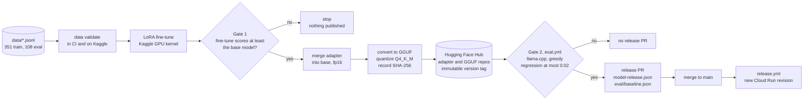

# Model pipeline

How training data becomes deployed weights, which gates a candidate must pass, and
how a model release rolls out and rolls back.

## 1. Current state

**The deployed model is the base TinyLlama-1.1B-Chat GGUF (Q4_K_M), not a
fine-tune.** `model-release.json` has `"finetuned": false` and points at
`TheBloke/TinyLlama-1.1B-Chat-v1.0-GGUF` at a pinned commit, with its SHA-256. The
training pipeline has never run, because it needs Kaggle and Hugging Face
credentials that only the repository owner can create (audit finding F-04). Every
stage below is implemented; none has produced a release yet.

The base model's score on the held-out set, with the production backend, is the bar
the first fine-tune must clear (`eval/baseline.json`):

| Metric | Base TinyLlama Q4_K_M |
| --- | --- |
| Items | 108 |
| Composite score | 0.410 |
| Keyword recall | 0.418 |
| Code validity | 0.538 |
| ROUGE-L | 0.283 |

## 2. Pipeline

| Stage | Where | Code |
| --- | --- | --- |
| Validate | CI on every push, and first on Kaggle | `fastapi-assistant data validate`, `datasets_tools.py` |
| Train | Kaggle GPU kernel, started by `train.yml` | `kaggle/pipeline.py`, `training.py` |
| Gate 1 | Kaggle | `fastapi-assistant eval --baseline`, `evaluation.py` `gate` |
| Merge | Kaggle | `fastapi-assistant export merge`, `export.py` `merge_adapter` |
| GGUF export | Kaggle | `scripts/export_gguf.sh` |
| Publish | Kaggle to Hugging Face | `fastapi-assistant export push`, `export.py` `push_folder` |
| Gate 2 | GitHub Actions | `.github/workflows/eval.yml`, called by `train.yml` |
| Release PR | GitHub Actions | `train.yml` `pull-request` job |
| Rollout | GitHub Actions to Cloud Run | `.github/workflows/release.yml` |

## 3. Data

| File | Rows | Fields |
| --- | --- | --- |
| `data/fastapi_qa_train.jsonl` | 351 | `instruction`, `input`, `output` |
| `data/fastapi_qa_eval.jsonl` | 108 | `id`, `category`, `instruction`, `input`, `output`, `must_include` (API identifiers a correct answer must name) |

`fastapi-assistant data validate` (`datasets_tools.py`) fails on:

- schema violations, empty fields, or an output over 2,000 characters;
- a fenced Python block that does not parse;
- an eval row without an `id`, with a duplicate `id`, or with a `must_include`
  entry missing from its own reference answer;
- exact duplicates within a split, or an eval question that also appears in train;
- near-duplicate leakage between eval and train: questions compared by content
  words (Jaccard at least 0.7 by default), answers by 5-word shingles (Jaccard at
  least 0.6).

Near-duplicate questions inside the training set are reported as warnings only.

More pairs can be drafted from the FastAPI documentation with
`fastapi-assistant data generate` (`datagen.py`, Claude), then reviewed by hand and
merged with `data merge`.

## 4. Training on Kaggle

`train.yml` (manual dispatch, inputs `base_model`, `num_epochs`, `learning_rate`)
renders `kaggle/pipeline.py` with those inputs, the commit and `HF_NAMESPACE`, and
pushes it as a private GPU kernel (`kaggle/kernel-metadata.json`). It then polls
the kernel for up to 300 minutes and downloads its outputs.

| Setting | Value | Source |
| --- | --- | --- |
| Base model | `TinyLlama/TinyLlama-1.1B-Chat-v1.0` | `kaggle/pipeline.py` `CONFIG` |
| LoRA | r 16, alpha 32, dropout 0.05, on `q_proj`, `k_proj`, `v_proj`, `o_proj` | `kaggle/pipeline.py`, `config.py` |
| Optimisation | 3 epochs, learning rate 2e-4, batch 8, gradient accumulation 2 | `kaggle/pipeline.py` |
| Sequence length | 512 tokens | `config.py` `max_seq_length` |
| Loss | Completion-only: prompt tokens are masked with label -100 | `training.py`, `data.py` |
| Prompt format | `prompts.build_messages` and `encode_chat`, the same format serving uses | `data.py`, `prompts.py` |
| Version label | `v<YYYY.MM.DD>-<short commit>` | `kaggle/pipeline.py` |

Credentials needed: `KAGGLE_USERNAME` and `KAGGLE_KEY` (or `KAGGLE_API_TOKEN`) as
GitHub secrets, `HF_NAMESPACE` as a GitHub variable, and `HF_TOKEN` attached to the
kernel as a Kaggle secret. Without `HF_TOKEN` or a namespace, the kernel trains and
evaluates but publishes nothing, and `train.yml` stops.

## 5. Gate 1: beat the base model

On the GPU, the pipeline scores the base model (`eval --no-adapter`) and the
fine-tune on the 108-item eval set, then gates the fine-tune against the base
report with `--max-regression` set to minus `min_improvement` (default 0.0). The
fine-tune must therefore score at least as well as the base model, or the kernel
exits before merging or publishing.

## 6. Merge, GGUF export and quantisation

1. `export merge` loads the base model in fp16, applies the adapter, and calls
   `merge_and_unload`, writing a full model plus tokenizer.
2. `scripts/export_gguf.sh` clones llama.cpp at a pinned ref (`b11971`), converts
   the merged model to an f16 GGUF with `convert_hf_to_gguf.py`, builds
   `llama-quantize` (`GGML_NATIVE=OFF`), and quantizes to `Q4_K_M` (about 0.7 GB for
   1.1B parameters). The converter embeds the tokenizer's chat template, so serving
   uses the training prompt format without extra configuration.
3. The pipeline computes the SHA-256 of `model-Q4_K_M.gguf` (`hub.sha256_file`) and
   writes it into the release manifest.

## 7. Publishing to Hugging Face

`export push` uploads the adapter to `<HF_NAMESPACE>/fastapi-assistant-lora` and the
GGUF to `<HF_NAMESPACE>/fastapi-assistant-gguf`, with a generated model card
(`write_model_card`: base model, LoRA settings, eval summary). Each upload commit is
tagged with the version label. The tag is created with `exist_ok=False`, so the
tooling fails rather than move an existing tag. The manifest pins
`revision` to that tag.

A candidate is published before Gate 2. One that fails Gate 2 stays on the Hub under
its tag but is never named by `model-release.json`, so it is never deployed.

## 8. Gate 2: production backend eval

`eval.yml` scores what will actually be served: the GGUF on llama.cpp, greedy
decoding, 256 new tokens, on the eval set.

| Case | Reference | Rule |
| --- | --- | --- |
| Called from `train.yml` with the candidate manifest | The model in `main`'s `model-release.json`, re-scored on the same runner and eval set | Candidate composite must not be more than `MAX_REGRESSION` (0.02) below the reference |
| PR that changes `model-release.json` | Same as above | Same |
| PR that changes only prompts, engines, evaluation code or the eval set | The committed `eval/baseline.json` | Same; a PR that changes the eval set without changing the model must also commit a new baseline |

`evaluation.py` defines the metrics: keyword recall over `must_include`, code
validity (every Python block parses), and ROUGE-L against the reference. The
composite is their mean over the items where each applies.

## 9. Release manifest

`model-release.json` is the only source of truth for deployed weights. The release
PR replaces it together with `eval/baseline.json` and `eval/baseline.md`.

| Field | Current value | Becomes |
| --- | --- | --- |
| `model_version` | `base-tinyllama-q4km` | `MODEL_VERSION` (responses, metrics, usage), Cloud Run revision label, edge cache namespace |
| `base_model` | `TinyLlama/TinyLlama-1.1B-Chat-v1.0` | `BASE_MODEL_NAME` |
| `finetuned` | `false` | `FINETUNED_WEIGHTS`, reported as `uses_adapter` by `/health` |
| `chat_format` | `zephyr` | `LLAMACPP_CHAT_FORMAT`; absent for a fine-tune, which uses the GGUF's embedded template |
| `gguf.repo_id`, `gguf.filename`, `gguf.revision` | TheBloke repository, file and commit | `GGUF_REPO_ID`, `GGUF_FILENAME`, `GGUF_REVISION` |
| `gguf.sha256` | 64 hex characters | `GGUF_SHA256`, verified before load |
| `adapter` | `null` | `ADAPTER_REPO_ID`, `ADAPTER_REVISION` (transformers backend only) |
| `eval` | `null` | Eval summary of the release |

The translation is `export.manifest_env`, exposed as
`fastapi-assistant export env model-release.json`.

## 10. Rollout

1. Merging the release PR pushes `model-release.json` to `main`, which triggers
   `release.yml`.
2. `deploy-cloudrun` renders `deploy/cloudrun/service.yaml` from the manifest and
   deploys a new revision labelled with the model version.
3. The new instance downloads the GGUF at the pinned revision, verifies its
   SHA-256, and loads it. The startup probe holds traffic until `/ready` answers 200
   (up to 240 s). If the hash does not match, the load fails and the revision never
   becomes ready.
4. `deploy-edge` sets the Worker's `MODEL_VERSION` to the new version, which moves
   the shared answer cache to a new namespace so answers from the previous model are
   never served. While that job is skipped (F-10) this step is manual; with Upstash
   not configured the cache is off anyway.

## 11. Rollback

Revert the release PR. Release redeploys with the previous manifest, and the
previous weights are still on the Hub under their tag, so nothing is retrained or
re-exported. The previous release's `eval/baseline.json` returns with the revert,
so the gate compares future candidates against the restored model.

## 12. Known gaps

- Training has not run (F-04), so the fine-tune and its eval results do not exist.
- **Fixed during this review.** `train.yml` passes the commit SHA as `ref`, but
  `kaggle/pipeline.py` used to clone with `git clone --branch <ref>`, which rejects a
  commit hash. The pipeline now runs `git init`, `git fetch --depth 1 origin <ref>`
  and `git checkout FETCH_HEAD`. That form was checked to work against GitHub with
  both a commit SHA and a branch name. The rest of the pipeline is untested end to
  end until the first real run.
