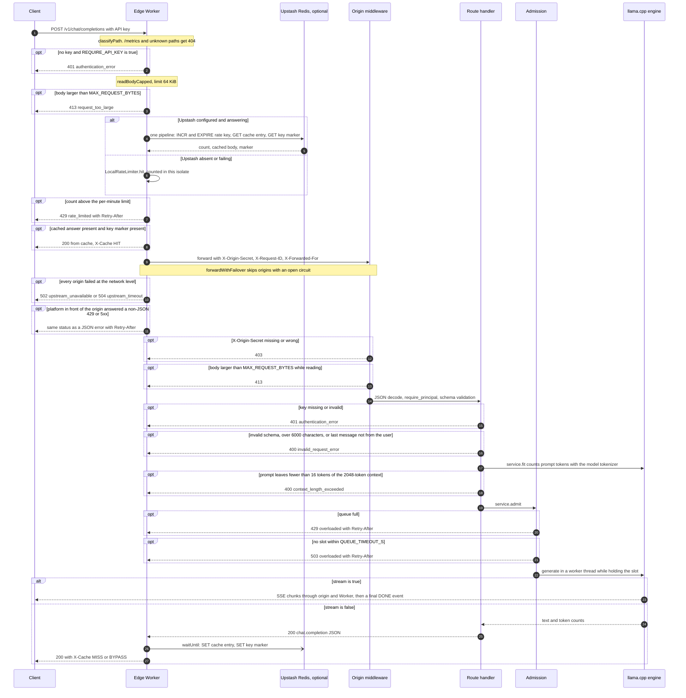

# Request lifecycle

How one `POST /v1/chat/completions` request travels through the edge Worker and the
origin, in the order the code runs, and where every status code comes from.
Component overview: [SYSTEM_ARCHITECTURE.md](SYSTEM_ARCHITECTURE.md).

Defaults in this document are the values in `deploy/cloudflare-worker/wrangler.toml`,
`deploy/cloudflare-worker/src/config.ts`, `src/fastapi_assistant/config.py`, and
the Cloud Run overrides in `deploy/cloudrun/service.yaml`.

## 1. Sequence

An origin response of 429, 502, 503 or 504 is retried on the next origin when one
exists. The last origin's response, whatever its status, is returned to the client,
rewritten into the edge's JSON error shape only if it is a non-JSON platform error.
Today `ORIGINS` lists only Cloud Run (audit F-11), so origin 429 and 503 responses
reach the client directly.

## 2. Edge steps

All in `deploy/cloudflare-worker/src/index.ts` (`handle`), unless noted.

| Step | Behaviour | Code |
| --- | --- | --- |
| 1. Route | `/metrics` is `blocked` and any path outside the contract is `unknown`: both get 404 without touching Redis or the origin. Built UI files never reach the Worker; Cloudflare serves them from `web/dist`. | `src/routes.ts`, `wrangler.toml` `[assets]` |
| 2. Key presence | On a protected path (`/generate`, `/v1/*`, not `OPTIONS`), a missing key is a 401 when `REQUIRE_API_KEY` is true (the default). The edge does not validate the key; the origin does. | `src/identity.ts` `extractApiKey` |
| 3. Identity | `key` identity: the first 32 hex characters of SHA-256(key), limit `RATE_LIMIT_PER_MINUTE` (20). Otherwise `ip` identity from `CF-Connecting-IP`, limit `RATE_LIMIT_PER_MINUTE_ANON` (10). | `src/identity.ts` |
| 4. Body cap | A declared `Content-Length` over 65,536 bytes is refused before reading; a chunked body is counted and abandoned once it crosses the cap. 413 `request_too_large`. The body is buffered so it can be hashed and replayed to a second origin. | `src/body.ts` |
| 5. Redis pipeline | One Upstash `/pipeline` call: `INCR rl:<id>:<minute>`, `EXPIRE ... 70`, and for cacheable requests `GET c:<model>:<hash>` and `GET kv:<id>`. 2 s timeout. | `src/ratelimit.ts`, `src/cache.ts`, `src/upstash.ts` |
| 6. Fallback limit | When Upstash is not configured or the pipeline throws, the same fixed window is counted in isolate memory. Rate limiting never turns off. | `src/ratelimit.ts` `LocalRateLimiter` |
| 7. 429 | Count above the limit: 429 `rate_limited`, `Retry-After` (seconds to the end of the window), `X-RateLimit-Limit`, `-Remaining`, `-Reset`. | `src/ratelimit.ts` |
| 8. Cache HIT rule | A request is cacheable only when Redis answered, it is a `POST` to `/generate` or `/v1/chat/completions`, the body is a JSON object of at most 64 KiB, and `stream` is absent, null or false. A stored answer is served only if the key's `kv:` marker exists, that is, the origin accepted this key within `KEY_VERIFIED_TTL_SECONDS` (300 s). Unknown keys always reach the origin. | `src/cache.ts`, `index.ts` step 5b |
| 9. Forward | Origins tried in order. Open circuits are skipped while another origin is available; if every circuit is open, all are tried. The timeout (`ORIGIN_TIMEOUT_MS`, 60 s) covers the wait for response headers only, never a streaming body. | `src/proxy.ts` `forwardWithFailover` |
| 10. Circuit breaker | Three consecutive network failures or timeouts open an origin's circuit for 30 s. Any HTTP response, even a 503, closes it. State is per isolate. | `src/proxy.ts` `CircuitBreaker`, `src/config.ts` |
| 11. Write-back | On a cache MISS: the key marker is written on any 2xx; the answer is written on a 200 JSON body of at most 64 KiB, with TTL `CACHE_TTL_SECONDS` (86,400). Both writes go in one pipeline inside `waitUntil`, so they do not delay the response. | `index.ts`, `src/cache.ts` |
| 12. Platform errors | If the response that survives failover is a 429, 502, 503 or 504 without a JSON content type, it came from the platform in front of the origin (for example Cloud Run's front end while a new instance starts), not from the app. The Worker discards the body and answers the same status in its JSON shape: type `overloaded` for 429, `upstream_unavailable` otherwise, with the platform's `Retry-After` or 10 s, and logs `upstream_normalized: true`. The app's own 429 and 503 are JSON and pass through unchanged. | `index.ts` (`PLATFORM_RETRY_AFTER_SECONDS`) |
| 13. Response headers | Strips `x-cloud-trace-context`, `server`, `via`, `alt-svc`; sets `nosniff`, `X-Cache` (`HIT`, `MISS` or `BYPASS`), `X-Served-By` (`edge-cache` or `origin-<n>`), `X-Request-ID`, rate-limit headers; rewrites an origin `Location` to the edge hostname. | `src/http.ts`, `src/proxy.ts` |

With Upstash not configured (audit F-03), every request is `X-Cache: BYPASS` and rate
limiting runs in the per-isolate fallback. The Worker deployed today predates that
fallback; see [DEPLOYMENT_ARCHITECTURE.md](DEPLOYMENT_ARCHITECTURE.md), section 1.

## 3. Origin steps

Middleware order was confirmed by building the app and reading
`app.user_middleware`: the `request_context` HTTP middleware is outermost, then
`BodySizeLimitMiddleware`, then `CORSMiddleware`.

| Step | Behaviour | Code |
| --- | --- | --- |
| 1. Origin lock | If `ORIGIN_SHARED_SECRET` is set and the path is not `/health`, `/ready` or `/metrics`, the `X-Origin-Secret` header must match (`hmac.compare_digest`), or the response is 403 `{"detail": "Direct origin access is not allowed"}`. | `api.py` `request_context` |
| 2. Body cap | `receive` is wrapped: a declared length over `MAX_REQUEST_BYTES` (65,536), or a streamed count over it, raises 413 on the first read, before JSON parsing. | `limits.py` |
| 3. JSON decode | Malformed JSON is a 400 on `/v1/*` (a 422 on `/generate`). | FastAPI, `api.py` `validation_error` |
| 4. Authentication | `require_principal`: the static `API_KEY` by constant-time compare, else SHA-256 lookup in Postgres through a TTL cache. 401 with `WWW-Authenticate: Bearer`. If neither `API_KEY` nor `DATABASE_URL` is configured, authentication is off. | `auth.py`, `api.py` |
| 5. Schema | Pydantic validation: 1 to 100 messages, each at most 8,000 characters; `max_tokens` 1 to 1,024; `n` must be 1. 400 on `/v1/*`, 422 on `/generate`. | `schemas.py` |
| 6. Character cap | The sum of message contents over `MAX_INPUT_CHARS` (6,000) is a 400 "Conversation is too long". | `api.py` `chat_completions` |
| 7. Retrieval | Only when enabled (`RAG_ENABLED`, false on Cloud Run). Failures degrade to no context. | `service.py` `retrieve` |
| 8. Normalise | Client system messages are dropped, the last `MAX_CHAT_TURNS` (6) turns kept, retrieved context attached. A conversation that does not end with a user message is a 400. | `prompts.py` `normalize_chat` |
| 9. Token budget | `service.fit` runs before admission. The llama.cpp tokenizer counts content tokens plus a deliberate over-estimate of template tokens (8 per message, 8 fixed). If fewer than 16 tokens of `LLAMACPP_N_CTX` (2,048) remain: 400 with `code: context_length_exceeded`. Otherwise `max_tokens` is clamped to the remaining room. | `engines/base.py` `fit`, `engines/llamacpp_engine.py` |
| 10. Admission | Up to `MAX_CONCURRENCY` (1) run; up to `MAX_QUEUE` (3 on Cloud Run) wait, each at most `QUEUE_TIMEOUT_S` (60 s on Cloud Run). Queue full: 429; wait expired: 503. Both use type `overloaded` and a `Retry-After` from a moving average of service time. | `admission.py`, `api.py` `admission_error` |
| 11. Generation | Runs in a worker thread holding the slot. `GENERATION_TIMEOUT_S` (60 s on Cloud Run, 120 s default) is checked per token and ends the answer with `finish_reason` `length` on the OpenAI API (`timeout` internally). | `service.py`, `engines/base.py` `Deadline` |
| 12. Response | Non-streaming: JSON `chat.completion`; usage recorded in a background task. Streaming: see section 5. Every response gets `X-Request-ID`, `X-Process-Time-Ms`, `nosniff`, `X-Frame-Options: DENY`, `Referrer-Policy: no-referrer`. | `api.py` |

A request that arrives while the model is still loading waits inside step 9:
`count_prompt_tokens` calls `load()`, which blocks on the load lock until the weights
are ready. If the load fails, the request gets 503 `model_not_ready` with
`Retry-After: 30`.

## 4. Status codes

Edge errors use `{"error": {"message", "type"}}` (`src/http.ts`). Origin errors on
`/v1/*` use the OpenAI envelope `{"error": {"message", "type", "code"}}`; on other
paths `{"detail": ...}` (`api.py` `_error`).

| Status | Type or code | Origin of the response | Condition | Code |
| --- | --- | --- | --- | --- |
| 200 | `chat.completion` or SSE | Origin | Success | `api.py` |
| 200 | cached JSON, `X-Cache: HIT` | Edge | Cache HIT rule satisfied | `index.ts` |
| 400 | `invalid_request_error` | Origin | Malformed JSON, schema violation, over 6,000 characters, or last message not from the user | `api.py`, `schemas.py`, `prompts.py` |
| 400 | `invalid_request_error`, code `context_length_exceeded` | Origin | Prompt does not fit the context window with 16 tokens to spare | `engines/base.py`, `api.py` |
| 401 | `authentication_error` | Edge | Protected path, no key, `REQUIRE_API_KEY` true | `index.ts` |
| 401 | `authentication_error` | Origin | Key missing or not recognised | `auth.py`, `api.py` |
| 403 | `{"detail": ...}` | Origin | `X-Origin-Secret` missing or wrong (direct origin access) | `api.py` `request_context` |
| 404 | `not_found` | Edge | `/metrics`, or a path outside the contract | `routes.ts`, `index.ts` |
| 413 | `request_too_large` | Edge | Body over 65,536 bytes | `body.ts`, `index.ts` |
| 413 | `invalid_request_error`, code 413 | Origin | Body over `MAX_REQUEST_BYTES`; reachable directly or if the edge cap is raised | `limits.py` |
| 429 | `rate_limited` | Edge | Per-minute limit exceeded (Redis or per-isolate) | `ratelimit.ts`, `index.ts` |
| 429 | `overloaded` | Origin | Admission queue full | `admission.py`, `api.py` |
| 429 | `overloaded` | Edge, normalised | The platform in front of the origin answered a non-JSON 429 (seen during a cold scale-out) | `index.ts` |
| 500 | `server_error` | Origin | Engine raised during a non-streaming generation ("Generation failed") | `api.py` |
| 500 | `edge_error` | Edge | Uncaught exception in the Worker | `index.ts` `createHandler` |
| 502 | `upstream_unavailable` | Edge | No origin configured, or every attempt failed at the network level without a timeout on the last one | `index.ts`, `proxy.ts` |
| 503 | `overloaded` | Origin | No slot within `QUEUE_TIMEOUT_S` | `admission.py`, `api.py` |
| 503 | `model_not_ready` | Origin | Model failed to load; `Retry-After: 30` | `api.py` `not_ready_error` |
| 502, 503, 504 | `upstream_unavailable` | Edge, normalised | The platform in front of the origin answered a non-JSON 5xx | `index.ts` |
| 504 | `upstream_timeout` | Edge | The last attempt did not return headers within `ORIGIN_TIMEOUT_MS` | `index.ts`, `proxy.ts` |

`POST /generate` follows the same path with these differences (`api.py` `generate`,
`schemas.py` `GenerateRequest`):

- schema and JSON errors are 422 with FastAPI's `{"detail": [...]}` list;
- the question is capped at 4,000 characters by the schema, and there is no
  separate character check or turn handling;
- retrieval is chosen per request with `use_retrieval`;
- streaming uses named SSE events (`token`, `done`, `error`) instead of OpenAI chunks.

The Cloud Run front end can also refuse a request by itself, for example with a
plain-text `429 Rate exceeded.` while a second instance starts
([docs/audit/PERFORMANCE_BASELINE.md](../audit/PERFORMANCE_BASELINE.md)). Through the
edge, clients receive those as the normalised edge errors in the table above.

## 5. Streaming

- The Worker never caches a streaming request (`wantsStream` in `src/cache.ts`), and
  passes the origin's body through unbuffered (`src/proxy.ts`).
- The origin acquires the admission slot, then returns a `StreamingResponse`. The
  first chunk is `{"role": "assistant"}`, then one chunk per token, a final chunk with
  `finish_reason`, and `data: [DONE]` (`api.py`).
- A failure after the 200 is reported in-band: `{"error": {"type":
  "invalid_request_error", "code": "context_length_exceeded"}}` (the backstop in
  `engines/llamacpp_engine.py` `_context_errors`) or `{"error": {"type":
  "server_error"}}`, followed by `[DONE]`.
- When the client disconnects, `service.stream` sets the cancel event, the engine
  stops at the next token (`Deadline`), and the slot is released by the
  `StreamingResponse` background task.

## 6. Timeouts and budgets

| Budget | Value | Covers | Code |
| --- | --- | --- | --- |
| Upstash pipeline | 2 s | One Redis round trip | `src/config.ts` `REDIS_TIMEOUT_MS` |
| `ORIGIN_TIMEOUT_MS` | 150 s per origin (`wrangler.toml`; 60 s code default) | Time until response headers | `wrangler.toml`, `src/proxy.ts` |
| `QUEUE_TIMEOUT_S` | 60 s on Cloud Run (30 s default) | Wait for an admission slot | `deploy/cloudrun/service.yaml` |
| `GENERATION_TIMEOUT_S` | 60 s on Cloud Run (120 s default) | Decode loop | `deploy/cloudrun/service.yaml`, `config.py` |
| Cloud Run request timeout | 300 s | Whole request, including a stream | `deploy/cloudrun/service.yaml` `timeoutSeconds` |

These budgets interact. For a non-streaming request the origin sends headers only
after generation finishes, so queue wait plus generation must fit inside the edge's
timeout. The deployed values keep that invariant: 60 s of queue plus 60 s of
generation is 120 s, under the edge's 150 s, so the origin always answers first. A
long answer is cut at 60 s of generation (about 500 tokens at the measured 8 to 10
tokens/s) and returned with `finish_reason` `length`, rather than lost behind a 504.

Residual: a client that disconnects from a non-streaming request early does not stop
its generation (`service.complete` has no cancellation path); it runs to completion
or to the 60 s budget. Streaming requests stop when the client disconnects. Changing
any of the three values must preserve
`QUEUE_TIMEOUT_S + GENERATION_TIMEOUT_S < ORIGIN_TIMEOUT_MS`.
