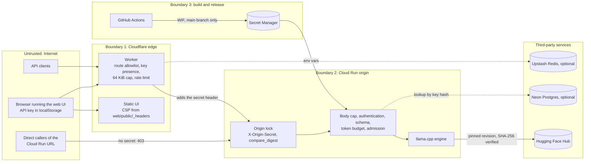

# Security architecture

The trust boundaries of the system and the control the code applies at each one.
This is a description of mechanisms. The threat model, attack scenarios and open
findings are in [docs/security/SECURITY_AUDIT.md](../security/SECURITY_AUDIT.md);
the baseline findings (F-01 to F-21) are in
[docs/audit/INITIAL_AUDIT.md](../audit/INITIAL_AUDIT.md).

## 1. Trust boundaries

| Boundary | What crosses it | Controls | Code |
| --- | --- | --- | --- |
| Internet to edge | HTTP requests with an API key | Path allowlist (unknown paths 404, `/metrics` blocked), key presence, 64 KiB body cap, per-key and per-IP rate limit, response header hygiene | `deploy/cloudflare-worker/src/` |
| Internet to origin | Requests that bypass the edge | Cloud Run ingress is `all` with `allUsers` as invoker, so the origin secret is the barrier: 403 without it | `api.py` `request_context`, `deploy/cloudrun/service.yaml`, `release.yml` |
| Edge to origin | Forwarded requests | Shared secret header; client-supplied `x-origin-secret`, `x-forwarded-for`, `x-request-id`, hop-by-hop and `cf-*` headers are stripped before forwarding | `src/proxy.ts` `buildForwardHeaders` |
| Origin to model weights | GGUF download | Pinned Hub revision, SHA-256 verified before load, fail closed | `hub.py` |
| Origin to Postgres | Key lookups, usage, feedback | Keys stored and queried only as SHA-256 hashes; TLS by connection string (`sslmode=require` in the runbook) | `storage/`, `auth.py` |
| CI to cloud | Deploys, secrets | Workload Identity Federation restricted to this repository's `main`; no long-lived cloud keys | `deploy/gcp/bootstrap.sh`, `release.yml` |

## 2. Authentication and authorisation

### Origin lock

- When `ORIGIN_SHARED_SECRET` is set, every request except `/health`, `/ready` and
  `/metrics` must carry `X-Origin-Secret` with the same value, compared with
  `hmac.compare_digest` (constant time). Otherwise: 403 before the body is read
  (`api.py` `request_context`, the outermost middleware).
- The Worker sets the header from its own secret and drops any value the client sent
  (`src/proxy.ts`).
- The secret is 32 random bytes, hex-encoded (`scripts/setup_secrets.sh`). Release
  refuses to deploy if it is missing (`release.yml`, secret sync).

### API keys

| Aspect | Implementation | Code |
| --- | --- | --- |
| Transport | `X-API-Key: <key>` or `Authorization: Bearer <key>` | `auth.py` `extract_api_key`, `src/identity.ts` |
| Edge | Checks presence only (401 when absent). The key is hashed (SHA-256, first 128 bits) to form the rate-limit identity and is never logged or stored in Redis. | `index.ts`, `src/identity.ts` |
| Static key | `API_KEY` compared with `hmac.compare_digest`; `fa_` plus 32 random bytes hex (`scripts/setup_secrets.sh`) | `auth.py` |
| Per-user keys | `fa_` plus `secrets.token_urlsafe(32)` (256 bits). Only `sha256(key)` is stored (`api_keys.key_hash`); the plaintext is printed once by `fastapi-assistant keys create`. | `storage/base.py` |
| Lookup cache | In-process TTL cache keyed by the hash: hits for `KEY_CACHE_TTL_S` (60 s), misses for at most 10 s. Revocation takes effect within the TTL. | `auth.py` `_TTLCache` |
| Off switch | With neither `API_KEY` nor `DATABASE_URL`, every caller is `anonymous`. Production always sets `API_KEY` (the Release sync fails without it). | `auth.py`, `release.yml` |

Why a fast hash is the right choice here: the keys are 256-bit uniformly random
values, not human-chosen passwords. Recovering a key from its SHA-256 would take on
the order of 2^255 guesses, so a slow password hash (bcrypt, scrypt, Argon2) adds no
practical protection. It would add cost to every request, because the hash is
computed before the TTL cache lookup. CodeQL alert #2
(`py/weak-sensitive-data-hashing` on `storage/base.py` `hash_api_key`) is accepted
for this reason (F-15).

### Metrics

`/metrics` is blocked at the edge (404). At the origin it is exempt from the origin
lock so a scraper can reach it directly. When `METRICS_TOKEN` is set it requires
`Authorization: Bearer <token>`, compared with `hmac.compare_digest` (`api.py`
`metrics_endpoint`). Release requires the token. Without it, the endpoint would be
open.

## 3. Browser-facing controls

| Control | Value | Code |
| --- | --- | --- |
| CORS | `allow_origins` from `CORS_ALLOW_ORIGINS` (default `*`), `allow_credentials=False`, methods `GET`, `POST`, `OPTIONS`. Authentication is a header, never a cookie, so a wildcard origin does not enable cross-site request forgery (F-18). | `api.py`, `config.py` |
| Origin response headers | `X-Content-Type-Options: nosniff`, `X-Frame-Options: DENY`, `Referrer-Policy: no-referrer` on every response | `api.py` `_SECURITY_HEADERS` |
| Worker response headers | `nosniff` on every response it produces or relays; removes `x-cloud-trace-context`, `server`, `via`, `alt-svc` | `src/http.ts` |
| Web UI headers | CSP `default-src 'self'; script-src 'self'; style-src 'self'; img-src 'self' data:; connect-src 'self' https: ...; object-src 'none'; base-uri 'none'; frame-ancestors 'none'`, plus `nosniff`, `X-Frame-Options: DENY`, `Referrer-Policy`, `Permissions-Policy`, `Cross-Origin-Opener-Policy` | `web/public/_headers` |
| Markdown rendering | `react-markdown` without a raw-HTML plugin, so model output cannot inject markup; `img-src` blocks remote images (tracking pixels) | `web/src/components/Markdown.tsx`, `web/public/_headers` |

The UI keeps the API key in `localStorage` (`web/src/state/settings.ts`). A script
injected into the page could read it; the CSP (`script-src 'self'`, no inline
script) and escaped Markdown are what prevent such a script.

## 4. Input and resource limits

Each limit stops a class of abuse before it reaches the expensive step.

| Limit | Value | Enforced at | Code |
| --- | --- | --- | --- |
| Path allowlist | Unknown paths 404 | Edge | `src/routes.ts` |
| Request body | 65,536 bytes, declared and streamed | Edge and origin | `src/body.ts`, `limits.py` |
| Rate limit | 20 per minute per key, 10 per minute per IP | Edge, Redis or per isolate | `src/ratelimit.ts` |
| Schema | Up to 100 messages of up to 8,000 characters; `max_tokens` up to 1,024; question up to 4,000 characters | Origin | `schemas.py` |
| Conversation | Up to 6,000 characters (`MAX_INPUT_CHARS`), last 6 turns | Origin | `api.py`, `prompts.py` |
| System prompt | Client system messages are dropped; the service's own prompt is always used | Origin | `prompts.py` `normalize_chat` |
| Prompt tokens | Must leave 16 tokens of the 2,048-token context; answer clamped to the room left | Origin, before admission | `engines/base.py` `fit` |
| Concurrency | 1 generation per instance, 3 waiting, 60 s queue timeout | Origin | `admission.py`, `service.yaml` |
| Generation time | 120 s per generation, checked per token | Origin | `engines/base.py` `Deadline` |
| Spend | `maxScale` 2 by default; budget alert notifies only | Cloud Run | `service.yaml`, `bootstrap.sh` |

Client-facing error messages are fixed strings ("Generation failed", "Model not
ready"). Load errors are logged server-side and never returned (`api.py` `ready`).

## 5. Secrets

| Secret | Generated by | Stored in | Used by |
| --- | --- | --- | --- |
| `ORIGIN_SHARED_SECRET` | `scripts/setup_secrets.sh` (32 random bytes) | Worker secret, GitHub secret, Secret Manager | Edge and origin |
| `API_KEY` | `scripts/setup_secrets.sh` (32 random bytes) | GitHub secret, Secret Manager | Origin |
| `METRICS_TOKEN` | `scripts/setup_secrets.sh` (24 random bytes) | GitHub secret, Secret Manager, a private local file | Origin, metrics scraper |
| Upstash URL and token | Upstash console (optional) | Worker secrets, GitHub secrets | Edge |
| `DATABASE_URL`, `SENTRY_DSN` | Neon, Sentry (optional) | GitHub secrets, Secret Manager (`disabled` placeholder when absent) | Origin |
| `HF_TOKEN` | Hugging Face | Kaggle kernel secret | Training pipeline only |

No secret appears in `wrangler.toml`, `service.yaml` or any tracked file; the
service spec references Secret Manager entries by name. The runtime service account
can only read secrets (`roles/secretmanager.secretAccessor`).

## 6. Model artifact integrity

- `model-release.json` pins the GGUF by repository, file name, Hub commit and
  SHA-256.
- `hub.resolve_gguf_path` downloads at that revision and calls `verify_sha256`,
  which raises on a mismatch. The load state becomes `failed`, `/ready` stays 503,
  and the Cloud Run startup probe never passes, so a substituted or corrupted file
  is never served.
- Verification is skipped only when `GGUF_SHA256` is unset; `config.py` rejects a
  value that is not 64 hex characters.
- The training pipeline records the SHA-256 of the file it publishes
  (`kaggle/pipeline.py`) and tags each Hub release with `exist_ok=False`, so the
  tooling never moves an existing tag (`export.py` `push_folder`).

## 7. Supply chain

| Control | Where | Effect |
| --- | --- | --- |
| Hash-pinned serving lock | `requirements/serve.txt` (`make lock`, `uv pip compile --generate-hashes`); `Dockerfile` `pip wheel --require-hashes` | The image build fails on any artifact whose hash differs |
| Lockfile installs | `npm ci` in CI and Release for the Worker and the web UI | Reproducible JavaScript dependencies |
| Pinned Actions | Third-party actions (Docker, Trivy, Google, Cloudflare, gitleaks, k6) pinned to commit SHAs; GitHub-owned `actions/*` and `github/codeql-action` by major tag | A moved third-party tag cannot change the pipeline |
| Least-privilege tokens | Every workflow sets explicit top-level `permissions` (mostly `contents: read`); jobs add only what they need, such as `id-token: write` for the Cloud Run deploy | |
| Trivy | CI `image` job and Release `scan` job | Fails on fixable HIGH or CRITICAL CVEs in the image |
| CodeQL | `.github/workflows/codeql.yml` | Python, JavaScript/TypeScript, Actions |
| gitleaks | CI `secrets` job, full history (`fetch-depth: 0`) | Fails on committed secrets |
| pip-audit | `.github/workflows/security.yml` on `requirements/serve.txt` | Fails on known-vulnerable Python dependencies; one reviewed exception (`PYSEC-2026-2447`, unreachable code path) |
| npm audit | `security.yml`, Worker and web | Fails on any advisory in production dependencies, and on high or critical in any dependency |
| Dependency review | `security.yml`, pull requests | Fails a PR that adds a high-severity dependency |
| Dependabot | `.github/dependabot.yml` | Weekly updates for pip, npm, Docker, Compose and Actions |
| Minimal runtime image | `Dockerfile` | No compiler, no pip, setuptools or wheel; Debian updates applied; uid 10001 |

## 8. Logging and privacy

| Data | Treatment | Code |
| --- | --- | --- |
| API keys | Never logged at the edge or the origin; the edge logs only the identity type (`key` or `ip`) | `index.ts`, `api.py` |
| Questions and answers | Stored with usage events only when `STORE_TRANSCRIPTS=true` (default false) | `service.py` `record_usage` |
| Feedback | Stored in Postgres; without a database, the rating and comment are written to the log | `api.py` `feedback` |
| Errors | Sentry only when `SENTRY_DSN` is a URL, with `send_default_pii=False` | `api.py` `_init_sentry` |
| Request ids | Client `X-Request-ID` accepted at the edge only if it matches `[A-Za-z0-9._:-]{1,128}` | `src/http.ts` `sanitizeRequestId` |

## 9. Known limits

Accepted or open, each traceable to code:

- **Key presence is not key validity at the edge.** Any non-empty key string passes
  the edge, and each distinct string gets its own per-key rate-limit bucket
  (`index.ts`, identity selection). The origin rejects unknown keys at
  authentication, after the body cap and JSON decode and before any model work.
- **The fallback rate limiter is per isolate.** Without Upstash, each Cloudflare
  isolate counts separately, so the effective limit is a multiple of the configured
  one (`src/ratelimit.ts`). See [DECISIONS.md](DECISIONS.md), ADR-008. The Worker
  deployed today predates this fallback, so no rate limit is live until it is
  redeployed ([docs/IMPLEMENTATION_STATUS.md](../IMPLEMENTATION_STATUS.md)).
- **Probes are public** and report backend and model version (F-16, accepted).
- **CORS allows any origin** (F-18, accepted; header authentication).
- **Controls that switch off when unset:** origin lock (`ORIGIN_SHARED_SECRET`),
  authentication (`API_KEY`, `DATABASE_URL`), metrics token (`METRICS_TOKEN`) and
  weight verification (`GGUF_SHA256`). Release requires the first three for Cloud
  Run, and `model-release.json` carries the fourth.
