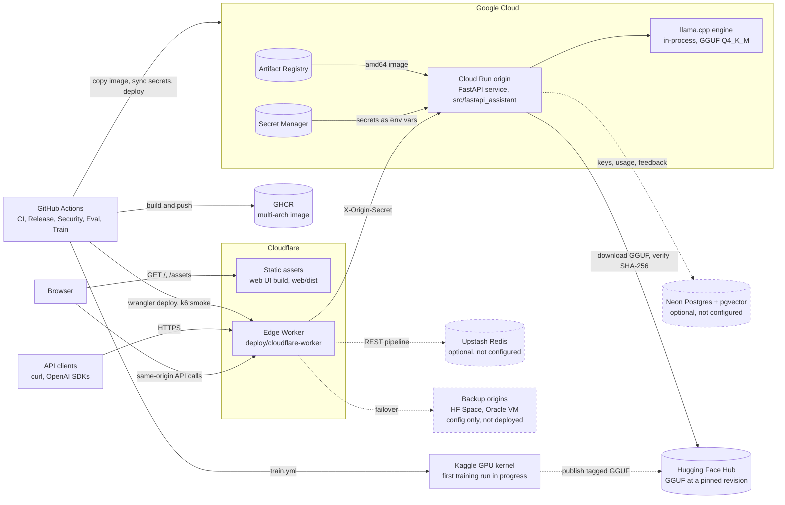

# System architecture

This document set describes the system as the code implements it, for engineers who
evaluate or contribute to the project. Every behaviour below is traced to a file in
the repository. Measured figures come only from
[docs/audit/INITIAL_AUDIT.md](../audit/INITIAL_AUDIT.md).

| Document | Covers |
| --- | --- |
| SYSTEM_ARCHITECTURE.md (this file) | Components, responsibilities, runtime topology |
| [REQUEST_LIFECYCLE.md](REQUEST_LIFECYCLE.md) | One `/v1/chat/completions` request through the edge and the origin, every status code |
| [DEPLOYMENT_ARCHITECTURE.md](DEPLOYMENT_ARCHITECTURE.md) | What is live, the Release pipeline, Cloud Run settings |
| [SECURITY_ARCHITECTURE.md](SECURITY_ARCHITECTURE.md) | Trust boundaries and the controls at each one |
| [MODEL_PIPELINE.md](MODEL_PIPELINE.md) | Data, training, export, eval gates, release and rollback of weights |
| [DECISIONS.md](DECISIONS.md) | Architecture decision records |

Related: [docs/ARCHITECTURE.md](../ARCHITECTURE.md) (the original high-level design and
its scaling path), [docs/DEPLOYMENT.md](../DEPLOYMENT.md) (the setup runbook),
[docs/IMPLEMENTATION_STATUS.md](../IMPLEMENTATION_STATUS.md) (what is live today),
[README.md](../../README.md) (quickstart and API).

These documents describe the code on `main`. The hardening changes described here
were merged in PR #13 and are live, together with the follow-ups #14 to #16: the
Release workflow deploys both Cloud Run and the edge Worker from `main`.

## 1. What the system is

A FastAPI-specialised small language model served as an HTTP service with a native
API (`POST /generate`) and an OpenAI-compatible API (`/v1/chat/completions`,
`/v1/models`, `/v1/feedback`). The model is TinyLlama-1.1B-Chat, intended to carry a
LoRA fine-tune, served as a quantized GGUF by llama.cpp on CPU.

The deployed model is currently the base TinyLlama GGUF, not a fine-tune
(`"finetuned": false` in `model-release.json`; audit finding F-04). See
[MODEL_PIPELINE.md](MODEL_PIPELINE.md).

## 2. Context diagram

Dashed nodes are optional or not deployed, and dashed links have not been used in
production yet (no fine-tune has been published). Solid nodes and links are live or
in use, according to the audit's live deployment baseline and the implementation
status.

## 3. Components and responsibilities

### Edge (Cloudflare Worker)

| Module | Responsibility |
| --- | --- |
| `deploy/cloudflare-worker/src/index.ts` | The request pipeline: route check, key presence, body cap, rate limit, cache lookup, forward, normalisation of non-JSON platform errors, cache write-back, response header hygiene. One JSON log line per request. |
| `src/routes.ts` | Classifies paths as `protected` (`/generate`, `/v1/*`), `public` (`/health`, `/ready`, `/docs`, `/redoc`, `/openapi.json`), `blocked` (`/metrics`) or `unknown` (404 at the edge, so scanners never wake a scaled-to-zero origin). |
| `src/identity.ts` | Reads the key from `X-API-Key` or `Authorization: Bearer`. The rate-limit identity is the first 32 hex characters of the key's SHA-256, or `ip:<CF-Connecting-IP>` for anonymous calls. The raw key never leaves this module. |
| `src/body.ts` | Buffers the request body once, capped at `MAX_REQUEST_BYTES` (64 KiB). Checks the declared length first, then counts streamed bytes. |
| `src/ratelimit.ts` | Fixed one-minute window: `INCR` plus `EXPIRE 70` on Redis, or `LocalRateLimiter` (per isolate, at most 10,000 identities) when Upstash is absent or fails. |
| `src/upstash.ts` | Minimal Upstash REST client: one `/pipeline` HTTP call per use, 2 s timeout (`REDIS_TIMEOUT_MS`). |
| `src/cache.ts` | Shared answer cache keyed by `MODEL_VERSION` and the SHA-256 of path plus canonical JSON body. Verified-key marker `kv:<identity>`. |
| `src/proxy.ts` | Builds forwarded headers (strips hop-by-hop, `cf-*` and client-supplied `x-origin-secret`; sets the real secret, `x-request-id`, `x-forwarded-for`). Ordered failover across `ORIGINS`, per-isolate `CircuitBreaker`, `Location` rewrite. |
| `src/http.ts` | Edge error envelope `{"error": {"message", "type"}}`, `X-Content-Type-Options: nosniff`, strips `x-cloud-trace-context`, `server`, `via`, `alt-svc` from origin responses. |
| `src/config.ts` | Parses `[vars]` and secrets with defaults (`DEFAULTS`). |
| `wrangler.toml` | Worker name `fastapi-assistant-edge`; `[assets] directory = "../../web/dist"`, so built UI files are answered by Cloudflare without invoking the Worker. |

### Web UI

| Path | Responsibility |
| --- | --- |
| `web/src/` | React + Vite playground: streaming answers, sources, usage, `Retry-After` handling, feedback, client snippets. The API key is kept in browser `localStorage` (`web/src/state/settings.ts`). |
| `web/public/_headers` | CSP and other browser security headers for the static files. |

### Origin (Python package `src/fastapi_assistant/`)

| Module | Responsibility |
| --- | --- |
| `api.py` | App factory `create_app`, routes, middleware (origin lock, request id, access log, metrics, security headers), error mapping to the native or OpenAI envelope. |
| `limits.py` | `BodySizeLimitMiddleware`: 413 before the body is parsed. |
| `auth.py`, `storage/` | Static `API_KEY` (constant-time compare) and per-user keys stored as SHA-256 hashes in Postgres, with an in-process TTL cache. Usage events and feedback. SQL migrations in `storage/migrations/`. |
| `service.py` | One code path for both APIs: retrieval, token budget (`fit`), admission, generation, metrics, usage accounting. |
| `admission.py` | Bounded concurrency plus a bounded wait queue. 429 or 503 with `Retry-After`. |
| `engines/base.py` | `Engine` contract, load-once lifecycle, `Deadline` (timeout and cancellation), `fit` (prompt token budget). |
| `engines/llamacpp_engine.py` | Production backend: GGUF on CPU, real tokenizer for `fit`, one generation at a time under a lock. |
| `engines/transformers_engine.py` | torch + LoRA adapter; used for training-time evaluation and development. |
| `engines/remote_engine.py` | Forwards to an OpenAI-compatible server (vLLM, TGI). Not used in production. |
| `hub.py` | Resolves the GGUF or adapter from local disk or the Hugging Face Hub at a pinned revision; `verify_sha256` fails the load on a mismatch. |
| `retrieval.py`, `docs_corpus.py` | Documentation index (local NumPy index baked into the image, or pgvector). Retrieval is opt-in per request. |
| `prompts.py` | The only definition of the prompt format, shared by training, evaluation and serving. Client system messages are dropped. |
| `metrics.py` | Prometheus registry per app instance: request, generation, tokens/s, queue depth and wait, time to first token, admission and prompt rejections. |
| `config.py` | Pydantic settings from the environment, validated at startup. |
| `evaluation.py`, `datasets_tools.py`, `datagen.py`, `training.py`, `export.py` | Offline model pipeline: eval harness and gate, dataset validation, Claude-assisted drafting, LoRA training, merge and Hub publishing. |
| `__main__.py` | CLI: `serve`, `eval`, `train`, `data`, `export`, `rag`, `db`, `keys`. |

### Deployment and pipeline

| Path | Responsibility |
| --- | --- |
| `Dockerfile` | Two-stage image: wheels built from the hash-pinned `requirements/serve.txt`, runtime as uid 10001 with no pip, setuptools or wheel. Weights are not baked in (`BAKE_MODEL=false`); the RAG index is (`BAKE_RAG_INDEX=true`). |
| `deploy/cloudrun/service.yaml` | Cloud Run service template, rendered by Release. |
| `deploy/gcp/bootstrap.sh` | One-time GCP setup: Artifact Registry, service accounts, Workload Identity Federation, budget alert. |
| `deploy/hf-space/`, `deploy/vm/` | Backup origin configurations. Not deployed (F-11). |
| `deploy/grafana/` | Dashboard and alert rules. |
| `.github/workflows/` | `ci`, `release`, `security`, `codeql`, `eval`, `train`, `uptime`. |
| `kaggle/pipeline.py`, `scripts/export_gguf.sh` | GPU training, merge, GGUF conversion and quantisation. |
| `model-release.json` | The deployed weights, pinned to a Hub revision and SHA-256. |

## 4. Runtime topology and state

| Tier | Where it runs | State it holds | Scaling unit |
| --- | --- | --- | --- |
| Static UI | Cloudflare Workers Static Assets | None | Cloudflare |
| Edge Worker | Cloudflare isolates | Per isolate: `LocalRateLimiter` counters and `CircuitBreaker` state. Lost when the isolate is recycled. | Cloudflare |
| Shared edge state | Upstash Redis (optional) | Rate counters `rl:*`, cached answers `c:*`, verified-key markers `kv:*` | Not configured today |
| Origin | Cloud Run instance, 2 vCPU, 2 GiB | Read-only model weights, auth TTL cache, admission counters, metrics registry | Instances: `minScale 0`, `maxScale` from `CLOUD_RUN_MAX_INSTANCES` (default 2) |
| Persistence | Neon Postgres (optional) | `api_keys`, `usage_events`, `feedback`, `doc_chunks` | Not required |
| Weights | Hugging Face Hub | GGUF at a pinned revision | Downloaded on cold start |

The origin is stateless apart from caches, so capacity grows by adding instances or
origins. Inside one instance, one generation runs at a time: `MAX_CONCURRENCY=1` in
`deploy/cloudrun/service.yaml`, and `LlamaCppEngine` holds a lock around each
generation.

## 5. Invariants

1. The prompt format lives only in `src/fastapi_assistant/prompts.py`. Training,
   evaluation and serving all call it; the GGUF converter embeds the same tokenizer
   chat template (`scripts/export_gguf.sh`).
2. Every request to an origin, except `/health`, `/ready` and `/metrics`, must carry
   the shared `X-Origin-Secret` when `ORIGIN_SHARED_SECRET` is set (`api.py`).
3. A prompt is measured in tokens and rejected or clamped before it takes an
   admission slot (`service.fit`, `engines/base.py`).
4. Deployed weights are named only by `model-release.json` (repository, file,
   revision, SHA-256). Weights are never committed to git.
5. Overload is answered quickly with 429 or 503 and `Retry-After`, never with an
   unbounded queue (`admission.py`).

## 6. Measured performance and capacity

From the audit's live baseline (single requests, Cloud Run, 2 vCPU, Q4_K_M):

| Measurement | Value |
| --- | --- |
| Decode throughput, one request | about 8 to 10 tokens/s |
| Streaming time to first token | 0.3 s (native SSE) to 1.1 s (OpenAI SDK) |
| `POST /generate`, 64 tokens | 8.6 s first call, 6.3 s repeat |

No load test has been run. The audit's capacity statement applies: one generation
per instance, at most two instances, further requests queued up to `MAX_QUEUE` and
then rejected with 429. No figure for supported users is claimed. Two one-off burst
probes and what they showed about scale-out are recorded in
[docs/audit/PERFORMANCE_BASELINE.md](../audit/PERFORMANCE_BASELINE.md).
