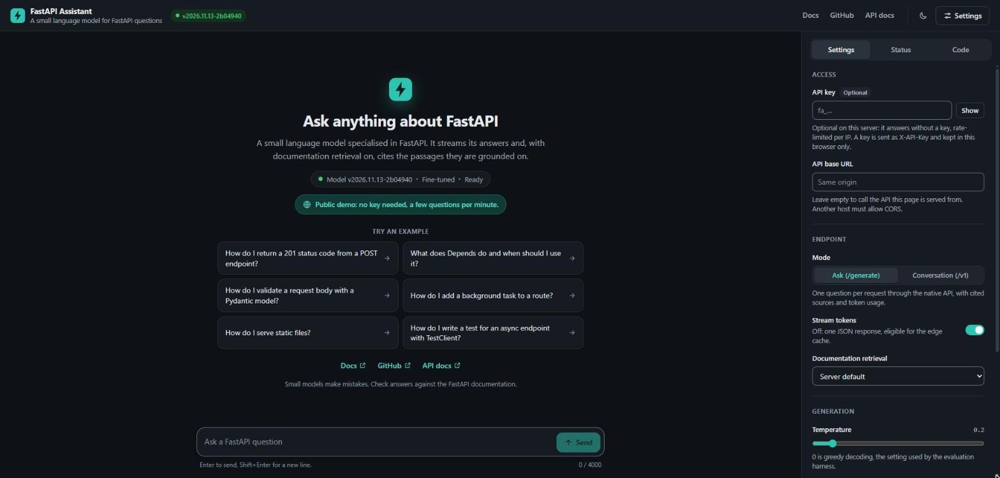

# FastAPI Niche Assistant

The FastAPI Niche Assistant is a small language model specialised in the FastAPI web
framework, served as an OpenAI-compatible API with streaming, retrieval over the official
documentation, per-user API keys, and an edge layer for rate limiting, caching and
origin failover. It runs on free-tier infrastructure, and its release pipeline ships a
new model only if it beats the current one on a held-out evaluation.

[Try the live demo](https://fastapi-assistant-edge.fastapi-assistant-edge.workers.dev){ .md-button .md-button--primary }
[Source on GitHub](https://github.com/syed-waleed-ahmed/Niche-Finetuned-Model){ .md-button }

!!! note "Status"

    The live service runs the base TinyLlama-1.1B-Chat model, quantized to GGUF. A
    fine-tuned release is being trained, and it replaces the base model only if it
    passes the evaluation gate. The [implementation status](IMPLEMENTATION_STATUS.md)
    page has the details.

## Start here

-   __Quickstart__

    ---

    Install the package, fetch the released model and serve the API on your own
    machine in a few commands.

    [Quickstart on GitHub](https://github.com/syed-waleed-ahmed/Niche-Finetuned-Model#quickstart)

-   __Architecture__

    ---

    How a request travels from the edge Worker to the model, what runs where, and the
    decisions behind the design.

    [Architecture overview](ARCHITECTURE.md)

-   __Operations runbook__

    ---

    Health checks, logs, metrics and the routine tasks: rotating secrets, deploying
    code and model releases.

    [Runbook](operations/RUNBOOK.md)

-   __Security__

    ---

    How to report a vulnerability privately, which versions receive fixes, and the
    risks that are accepted.

    [Security policy](project/security.md)

-   __Model card__

    ---

    The served model, its training data, evaluation results, intended use and known
    limitations.

    [Model card](project/model-card.md)

-   __Contributing__

    ---

    Development setup, the checks every pull request must pass, and the rules that
    protect the evaluation.

    [Contributing guide](project/contributing.md)

## The web UI

<figure class="screenshot" markdown="span">
  { loading=lazy }
  <figcaption>Ask a FastAPI question and get a streamed answer with the documentation
  passages it was grounded on. The badge in the header shows which model is serving.</figcaption>
</figure>
