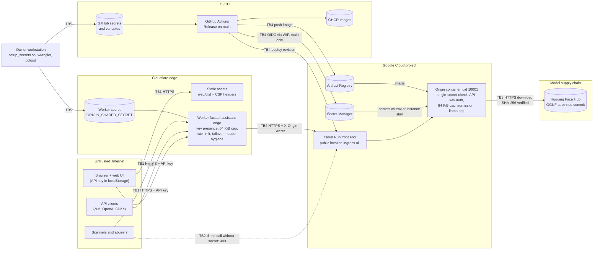

# Security audit

Date: 2026-11-13. This document is the security view of the system. It covers:

- the trust boundaries;
- a STRIDE threat model, with mitigations and residual risk;
- the status of every finding from [../audit/INITIAL_AUDIT.md](../audit/INITIAL_AUDIT.md);
- new observations from this review;
- prompt-injection and model-output risks;
- recommendations, ordered by value.

**Update, later the same day.** After this review the deployment was switched to
public demo mode (`PUBLIC_DEMO=true`, #24): the edge and the origin serve requests
without a key, limited to 10 a minute per IP per isolate, and `maxScale` was lowered
from 2 to 1. Rows S1, D1 and D7 say what that changes. The first fine-tuned model was
deployed (F-04, #33).

## 1. Scope and method

**In scope:**

| Area | Paths |
|---|---|
| Edge Worker | `deploy/cloudflare-worker/` |
| Web UI | `web/`, including `web/public/_headers` |
| Origin service | `src/fastapi_assistant/` (`api.py`, `auth.py`, `limits.py`, `admission.py`, `service.py`, `engines/`, `hub.py`, `config.py`, `storage/`, `prompts.py`) |
| Container image | `Dockerfile` |
| Cloud Run service | `deploy/cloudrun/service.yaml` |
| Google Cloud bootstrap | `deploy/gcp/bootstrap.sh` |
| Secrets tooling | `scripts/setup_secrets.sh` |
| Workflows | `.github/workflows/` (`ci`, `release`, `security`, `codeql`, `train`, `eval`, `uptime`) |
| Dependabot | `.github/dependabot.yml` |
| Model pin | `model-release.json` |

**Code state.** Reviewed on the hardening branch (`feat/production-hardening`) as of
2026-11-13: `f262379` (hardening) and `e438345`. The second commit adds the Worker
change that rewrites non-JSON 429 and 5xx responses from the origin's platform. That
branch was merged into `main` in PR #13 (`b146406`) and deployed, and the follow-ups
#14 to #16 are merged too. The statuses below were updated after those merges.

**Live state.** As recorded in INITIAL_AUDIT section 3 and in
[../audit/PERFORMANCE_BASELINE.md](../audit/PERFORMANCE_BASELINE.md).

**Method.**

- Manual review of the code paths and configuration listed above.
- Evidence reused from INITIAL_AUDIT: the tests, `pip-audit`, `npm audit`, gitleaks
  over the full history, CodeQL, Trivy, and the scripted live checks.
- The concurrency probes in PERFORMANCE_BASELINE.
- Wrangler's rollback and secret behaviour, checked against the wrangler version
  installed in `deploy/cloudflare-worker/node_modules`.

**Not done:**

- no penetration test, and no load test;
- no new live probes for this document;
- no review of settings outside the repository: GitHub branch protection and
  environment rules, GCP organisation policies, the Cloudflare account, and the
  practices of the third-party Hugging Face repository that hosts the current
  weights.

Where a conclusion depends on those settings, it says so.

Residual risk is rated **Low**, **Medium** or **High**, from likelihood and impact for
this deployment: a public demo API on free tiers, with no personal data stored by
default.

## 2. Assets

| Asset | Why it matters |
|---|---|
| `API_KEY` (static, shared) and database keys (future) | Grant use of the model and its compute. One shared key means a leak affects every client. |
| `ORIGIN_SHARED_SECRET` | Lets a caller bypass the edge (rate limits, key presence check, body cap) and talk to Cloud Run directly |
| `METRICS_TOKEN` | Read access to operational metrics |
| `DATABASE_URL` (future) | Full control of keys, usage and feedback: anyone with it can mint keys |
| Deploy authority: GitHub `main`, the Release workflow, and the deployer service account | Changes code, the model and secrets in production |
| Model integrity | The weights decide every answer; a substituted GGUF is code running inside llama.cpp's parser |
| Availability and the billing account | Compute is shared by all users and costs money beyond free tiers |
| User inputs and outputs | Questions, answers and feedback comments. Not stored by default (`STORE_TRANSCRIPTS=false`, no database), but feedback comments are logged (O-7). |

## 3. Trust boundaries

| Boundary | What crosses it | Main controls |
|---|---|---|
| TB1: Internet to edge | Static file requests, API calls with keys, probes, scanners | **API paths:** 404 for unknown paths and `/metrics`; 401 when no key is sent on protected paths; 413 above 64 KiB; per-key and per-IP fixed-window limits; request-id sanitising; removal of the `x-origin-secret`, `x-forwarded-for`, `x-request-id` and `cf-*` request headers. **Web UI files:** CSP and the other browser security headers. |
| TB2: Edge to origin | Forwarded requests over the public Cloud Run URL | `X-Origin-Secret` compared in constant time (`hmac.compare_digest`) on every path except `/health`, `/ready` and `/metrics`; `/metrics` needs its own bearer token. The origin also validates the API key and caps the body. The edge strips `x-cloud-trace-context`, `server`, `via` and `alt-svc` from responses. |
| TB3: Origin to Hugging Face Hub | The GGUF weights, downloaded at cold start | Pinned commit `revision` and a SHA-256 checked before load, which fails closed on a mismatch (`hub.verify_sha256`) |
| TB4: CI/CD to Google Cloud | Images, Cloud Run revisions, secret values | Workload Identity Federation: no long-lived keys; the provider accepts only this repository on `refs/heads/main`. Hash-pinned Python dependencies. Third-party actions pinned to commit SHAs. Trivy gate on fixable HIGH and CRITICAL. |
| TB5: Operator to secret stores | Generated secrets | `setup_secrets.sh` generates the values locally and pipes them to `gh` and `wrangler`, printing only the API key once |
| TB6: Model output to the browser (not drawn) | Answer text rendered as Markdown | `react-markdown` without raw HTML; strict `img-src`; links open with `noopener noreferrer` (section 8) |

## 4. STRIDE threat model

Statuses refer to `main` after the merge of #13, which is deployed to Cloud Run and to
the Worker. Items marked "edge" are enforced by the deployed Worker.

### Spoofing

| ID | Threat | Mitigations | Residual risk |
|---|---|---|---|
| S1 | Use of the API without a valid key | Edge rejects missing keys (401). Origin checks the static key with `hmac.compare_digest`, or a SHA-256 hash lookup in Postgres (`auth.py`). Keys are 256-bit random values. | **Medium.** One static key is shared by all clients. A leak means rotating it for everyone, and abuse cannot be tied to a client. Per-user keys need Neon (not configured). In public demo mode, requests without a key are served by design, so this row covers keyed access only; a wrong key is still rejected with 401. |
| S2 | Bypassing the edge by calling Cloud Run directly | Origin secret check returns 403 (verified live). The Worker never forwards a client-supplied `x-origin-secret`. | **Low.** The secret is static, with no rotation schedule, and shared by all origins. Leaking it removes every edge control. |
| S3 | Forging client identity or ids through headers | The Worker drops client `x-forwarded-for`, `x-request-id` (replaced by a sanitised or generated id) and `cf-*`. The origin only logs these values; it makes no security decision on them. | **Low** |
| S4 | A fork, a pull request or a non-`main` branch obtaining deploy credentials | The WIF provider condition is `assertion.repository == '<repo>' && assertion.ref == 'refs/heads/main'` (`bootstrap.sh`). Deploy jobs run only in Release, on pushes to `main` or dispatches. | **Medium.** Anyone who can get a commit onto `main` deploys with the deployer's rights (E3). Branch protection on `main` is now configured (the "Protect main" ruleset, O-4); protection rules for the `production` environment were not reviewed. |

### Tampering

| ID | Threat | Mitigations | Residual risk |
|---|---|---|---|
| T1 | Substituted or corrupted weights: Hugging Face account compromise, a moved revision, a corrupted download | Commit-pinned revision, plus SHA-256 verification before load (F-06). A mismatch fails the load, and a new revision never becomes ready. The hash is in `model-release.json`, which is reviewed in PRs and checked by the eval gate. | **Low.** The hash proves identity, not provenance. A compromised training pipeline or Hugging Face token at training time could publish a malicious GGUF together with a matching hash in the release PR. PR review and the eval gate are the controls. |
| T2 | Malicious or vulnerable Python dependency | `pip wheel --require-hashes` from `requirements/serve.txt`; `pip-audit` on PRs and weekly (`security.yml`); Dependabot; Trivy | **Low** |
| T3 | Compromised GitHub Action | Third-party actions pinned to commit SHAs. Dependabot watches the `github-actions` ecosystem. | **Low.** First-party actions (`actions/*`, `github/codeql-action`, `actions/dependency-review-action`) follow major-version tags (O-10). |
| T4 | Tampered image between build and deploy | Release copies the scanned amd64 digest into Artifact Registry under the commit tag. Cloud Run pulls from Artifact Registry with the runtime identity. | **Low** |
| T5 | Edge cache poisoning (once Upstash is enabled) | The cache key is the model version, path and canonical JSON body. Only 200 JSON responses up to 64 KiB are stored. Hits are served only to keys the origin accepted within 300 s. | **Low.** Answers are shared across callers who send byte-identical requests, by design. |
| T6 | Oversized or malformed bodies | 64 KiB cap at the edge (declared length and a streaming count) and at the origin (ASGI middleware before parsing) (F-02). Pydantic bounds on every field. | **Low** |

### Repudiation

| ID | Threat | Mitigations | Residual risk |
|---|---|---|---|
| R1 | Abuse that cannot be attributed | A request id is shared by Worker and origin logs. Database keys carry a `key_id` in usage events (not enabled). | **Medium.** Worker logs now record a 12-character prefix of the key's SHA-256 (`rl_key_id`, O-5, #27), so requests can be grouped by key. With one static key shared by all clients (S1), and no IP logged for anonymous calls, abuse still cannot be traced to a person. Origin logs see only the edge. Workers Logs retention is short. |

### Information disclosure

| ID | Threat | Mitigations | Residual risk |
|---|---|---|---|
| I1 | Secrets in source, history or CI output | gitleaks over the full history in CI. Release pipes secret values into Secret Manager without echoing them. `setup_secrets.sh` prints only the new API key, once. | **Low** for secret values. **Note:** Release prints the rendered service spec, which contains the GCP project id and the runtime service-account address, and the smoke step contains the Cloud Run URL. Both land in Actions logs that anyone with read access can see (O-1). |
| I2 | Internal details in error responses | Fixed client messages; load errors are logged, not returned; the edge returns a generic `edge_error`; validation errors are summarised | **Low** |
| I3 | Probe responses reveal backend and model version | Accepted (F-16): low sensitivity, useful for monitoring | **Low** |
| I4 | Infrastructure headers | The edge strips `x-cloud-trace-context`, `server`, `via` and `alt-svc` (F-07, edge) | **Low** |
| I5 | Theft of the API key from the browser | The key is held in `localStorage`. CSP is `script-src 'self'` with no inline scripts. `react-markdown` renders no raw HTML. `frame-ancestors 'none'` and `X-Frame-Options: DENY`. | **Low.** Any script execution in the page (an XSS bug, a malicious browser extension) can read the key. `connect-src https:` is deliberately broad, so the Settings page can target other deployments, which means the CSP would not stop exfiltration once a script runs. |
| I6 | Exposure of user content | Transcripts are not stored by default, and Sentry runs with `send_default_pii=False` | **Low.** Without a database, feedback comments (up to 2,000 characters) are written to the application log (O-7). |
| I7 | Metrics leakage | `/metrics` is 404 at the edge and needs a bearer token, compared in constant time, at the origin | **Low** |

### Denial of service (including cost)

| ID | Threat | Mitigations | Residual risk |
|---|---|---|---|
| D1 | Request floods exhausting compute or budget | Key presence check at the edge (not in public demo mode); per-key and per-IP limits (in-isolate today, F-03); admission control (1 running, 3 queued, then 429; 503 after 60 s); `containerConcurrency 4`; `maxScale` (2 at review time, 1 on the live public demo); budget alert | **Medium.** The in-isolate limiter counts per Cloudflare isolate. Every made-up key gets its own bucket and reaches the origin (cheap 401, but billable requests). One valid key can keep both instances busy. In public demo mode anyone can occupy the single instance without a key, held back only by the per-IP limit of 10 a minute per isolate; the cost stays bounded by `maxScale 1` (D7). The measured burst behaviour is in PERFORMANCE_BASELINE. |
| D2 | Long generations holding the only slot | `GENERATION_TIMEOUT_S=60` on Cloud Run, inside the edge's 150 s timeout together with the 60 s queue wait, so every generation ends in an answer; a generation stops when its client's disconnect reaches the app, streaming or not (#26, #38); the origin is served over HTTP/2 so that Cloud Run reports disconnects | **Low.** Cloud Run does not pass a client's disconnect on to the container over HTTP/1.1 ([Google's troubleshooting guide](https://cloud.google.com/run/docs/troubleshooting)), which was the live setup until #38. Measured on the live service after #37 (2026-11-14), a request sent right behind an abandoned generation waited 59.8 s (non-streaming) and 58.4 s (streamed). #38 serves the origin over HTTP/2; the measured result is in [IMPLEMENTATION_STATUS.md](../IMPLEMENTATION_STATUS.md), under "In progress". |
| D3 | Token-dense prompts | Token count with the loaded tokenizer before admission; 400 `context_length_exceeded` (F-01) | **Low** |
| D4 | A dead or slow origin stalling every request | Per-isolate circuit breaker; 504 on timeout (F-12, edge) | **Low** (a single origin today, so the breaker mostly affects logging) |
| D5 | Exhausting the Workers Free plan daily request limit | Cloudflare's platform protections. Edge 404s and 401s are cheap but still count. | **Medium.** Past the limit, the whole edge (API and probes) fails until the daily reset. |
| D6 | Hugging Face unavailable at cold start | Running instances keep serving | **Medium** (F-06 residual: weights are downloaded, not baked, to stay in free storage) |
| D7 | Denial of wallet | `maxScale` hard cap; budget alerts; request-based billing | **Medium.** The worst case is about 58 times the free vCPU allowance per month at `maxScale 2`, and about 29 times at the live setting of 1 ([../operations/COST_MANAGEMENT.md](../operations/COST_MANAGEMENT.md)). Alerts notify a person; nothing stops spending automatically. |

### Elevation of privilege

| ID | Threat | Mitigations | Residual risk |
|---|---|---|---|
| E1 | Code execution in the origin container | Non-root uid 10001. No compiler, pip, setuptools or wheel in the image. Debian security updates applied at build. Release fails on fixable HIGH and CRITICAL CVEs (F-20). gen2 sandbox. | **Low.** If code does run, the runtime service account can read every secret in the project (project-level `secretAccessor`). The secrets are also in the process environment. |
| E2 | Unsafe deserialisation (`diskcache`, PYSEC-2026-2447) | Unreachable (section 7) | **Low** |
| E3 | Abuse of CI deploy rights | WIF limited to `main` | **Medium.** The deployer account has project-level `run.admin`, `artifactregistry.writer` and `secretmanager.admin`, and can act as the runtime account (`bootstrap.sh`). A merged workflow change can read or replace every secret (O-4). |
| E4 | Prompt injection gaining capabilities | The model has no tools, no network access and no write access. Retrieval reads only the documentation index baked at build time. Client `system` messages are dropped (`prompts.normalize_chat`). | **Low.** The only effect is on the answer text (section 8). |
| E5 | Authentication silently disabled | Release refuses an empty `API_KEY` | **Low.** The settings loader treats `""`, `disabled`, `none` and `null` as unset for `API_KEY`. With no `DATABASE_URL`, the origin then accepts any caller. The edge still demands that some key header is present, but any string passes (O-3). |
| E6 | Key minting by anyone holding `DATABASE_URL` | `keys create` needs a direct database connection | **Low.** Treat `DATABASE_URL` as an administrator credential once Neon exists. |

## 5. Findings from the initial audit

Source: [../audit/INITIAL_AUDIT.md](../audit/INITIAL_AUDIT.md).

**What "fixed" means.** "Fixed" means fixed in code that is merged into `main` and
deployed. These fixes were made on `feat/production-hardening` and merged in #13
(`b146406`). Release redeployed Cloud Run, and the Worker was deployed from `main`
the same day (FINAL_VERIFICATION item 18). The edge parts are: the edge half of F-02,
F-03, F-07's header stripping, F-12, and the 429 normalisation. Since #15, Release
deploys the Worker on every run (F-10), so edge fixes no longer need a manual deploy.

| ID | Sev | Finding | Status | Notes |
|---|---|---|---|---|
| F-01 | P1 | Token-dense input under the character limit caused a 500 | Fixed | `fit` counts tokens before admission: 400 `context_length_exceeded`, `max_tokens` clamped; the CI image test asserts 400 |
| F-02 | P1 | Unbounded request bodies | Fixed | 64 KiB at the edge (`body.ts`) and the origin (`limits.py`); the CI image test asserts 413 |
| F-03 | P1 | No rate limiting live | Partially mitigated | The in-isolate fallback limiter is always on (edge). A shared limit needs Upstash, which is BLOCKED on an owner credential. |
| F-04 | P1 | Live model is the base TinyLlama | Fixed (#33) | The first fine-tuned release, `v2026.11.13-2b04940`, passed both eval gates (0.546 against the base model's 0.402 with the production backend) and is deployed. The first training runs exposed Kaggle environment problems, fixed in #15 and #16. |
| F-20 | P1 | HIGH CVEs with fixes in the image | Fixed | `apt-get upgrade`, packaging tools removed, Release gate on HIGH and CRITICAL (ignoring unfixed). All 14 Trivy code-scanning alerts (#7 to #20) are closed as fixed by the scan of the deployed image. |
| F-21 | P1 | False-positive secret alert on the RAG index | Fixed | `skip-dirs: /models/rag_index` with the reason next to it in `release.yml` |
| F-05 | P2 | 5xx labelled `invalid_request_error` | Fixed | 5xx is `server_error`; admission rejections are `overloaded` |
| F-06 | P2 | Cold start downloads the GGUF unchecked | Fixed for integrity | SHA-256 recorded and verified. The runtime dependency on Hugging Face remains by choice (baking costs storage); see D6. |
| F-07 | P2 | No browser security headers; trace header leaked | Fixed | UI: CSP, `nosniff`, `X-Frame-Options`, `Referrer-Policy`, `Permissions-Policy`, COOP. API: `nosniff`, `X-Frame-Options`, `Referrer-Policy`. Edge strips `x-cloud-trace-context`. |
| F-08 | P2 | Type checking not enforced | Fixed | mypy runs in CI |
| F-09 | P2 | Dependency audit not in CI | Fixed | `security.yml`: `pip-audit`, `npm audit`, dependency review on PRs, weekly schedule. Dependabot alert #1 (`diskcache`) is dismissed with the reason in section 7. |
| F-10 | P2 | Edge deploys are manual | Fixed | The `CLOUDFLARE_API_TOKEN` secret and `CLOUDFLARE_ACCOUNT_ID` variable are set. Release deploys the Worker (`deploy-edge`) and runs the k6 smoke test (`smoke-edge`); both succeeded in Release run 43460008003. A manual `wrangler deploy` is an emergency fallback (RUNBOOK 7.7). |
| F-11 | P2 | Only one origin live | BLOCKED | The Hugging Face Space needs an HF token; the VM is optional. Failover code is unit-tested only. |
| F-12 | P2 | A dead primary costs every request the full timeout; timeouts reported as 502 | Fixed | Circuit breaker (3 failures, 30 s); 504 `upstream_timeout` (edge) |
| F-13 | P2 | No queue-wait or TTFT metrics | Fixed | `assistant_queue_wait_seconds`, `assistant_time_to_first_token_seconds`, plus `assistant_prompt_too_long_total` |
| F-14 | P2 | Open-source governance files missing | Fixed | CONTRIBUTING, CODE_OF_CONDUCT, SECURITY, CHANGELOG, CITATION, MODEL_CARD, issue and PR templates merged in #13. Private vulnerability reporting is enabled. |
| F-15 | P3 | Two CodeQL alerts (key printed once by the CLI; fast hash for API keys) | Accepted | Intended behaviour. Keys are 256-bit random values, so a fast hash is correct. The owner dismissed both alerts as "won't fix". |
| F-16 | P3 | Public probes | Accepted | Low sensitivity; needed for uptime checks |
| F-17 | P3 | Legacy entry points | Accepted | Kept for backward compatibility |
| F-18 | P3 | CORS allows any origin | Accepted | Header authentication, never cookies, so no CSRF exposure |
| F-19 | P3 | `graphify-out/` tracked | Accepted | Deliberate; excluded from the Docker build context |

**Fixed during this pass, from the performance probes.** Cloud Run's front end
answered part of a 6-request burst with plain-text `429 Rate exceeded.` and no
`Retry-After`, while it scaled out to a second, cold instance. The Worker now rewrites
non-JSON 429, 502, 503 and 504 responses from the origin's platform into the JSON
error shape, adds `Retry-After: 10` when it is missing, and logs
`upstream_normalized: true` (edge). This is an availability and contract fix, not a
security fix. The probes are the only capacity evidence; no user capacity is claimed.

**Alert state after the merges (2026-11-13).**

| Source | State |
|---|---|
| CodeQL #1 and #2 | Dismissed by the owner as "won't fix" (F-15) |
| CodeQL #3 (`py/stack-trace-exposure`) | Introduced and fixed within #14; closed as fixed |
| Trivy #7 to #20 (image) | All 14 closed as fixed by the scan of the deployed image (F-20) |
| Dependabot #1 (`diskcache`, PYSEC-2026-2447) | Dismissed (section 7) |
| Private vulnerability reporting | Enabled |

## 6. Observations from this review

These are not in the initial audit. Each one cites the code that shows it.

| ID | Rating | Observation | Evidence |
|---|---|---|---|
| O-1 | Low | The GCP project id, the runtime service-account address and the Cloud Run URL appear in Release logs, which anyone with read access to the repository's Actions can see. The origin is protected by the shared secret, so this is not exploitable by itself, but it publishes values the operations docs treat as private. | `release.yml`: `cat service.rendered.yaml` (line 218); the `Smoke test the origin` step expands the URL (lines 230 to 232) |
| O-2 | Low (was Medium) | Mitigated (merged in #13): `GENERATION_TIMEOUT_S=60` and `QUEUE_TIMEOUT_S=60` on Cloud Run fit inside the edge's raised `ORIGIN_TIMEOUT_MS=150000`, so the edge no longer returns 504 while the origin keeps generating. The residual is fixed in the app (#26, #38): a generation is cancelled when its caller's disconnect reaches the service, streaming or not, and the slot is released. On Cloud Run it never arrived: Cloud Run does not pass a client's disconnect on to the container over HTTP/1.1 ([Google's troubleshooting guide](https://cloud.google.com/run/docs/troubleshooting)). Measured on the live service after #37 (2026-11-14), a request sent right behind an abandoned generation waited 59.8 s (non-streaming) and 58.4 s (streamed). #38 serves the origin over HTTP/2 (ADR-009), which Google documents as passing disconnects on. | `schemas.py` (`le=1024`); `service.complete` watches the connection and passes a cancel event to `engine.generate`; `tests/test_disconnect.py` |
| O-3 | Low | Placeholder values (`""`, `disabled`, `none`, `null`) for `API_KEY` silently disable origin authentication when no database is configured. Release rejects only an empty value. **Status:** Fixed (merged in #13): a placeholder `API_KEY` is rejected at startup, an empty one means unset, and an origin with no authentication logs a warning. | `config.py` `_unset_placeholders`; `auth.Authenticator.enabled`; `release.yml` "Sync secrets" |
| O-4 | Medium | The deployer service account holds project-wide `roles/secretmanager.admin` and `roles/run.admin`. Its protection is only as strong as the branch protection on `main`. **Status:** Partly mitigated. The "Protect main" ruleset is active: pull requests and the core CI and security checks are required, and force-pushes and deletion are blocked, with admin bypass only through a pull request. The roles themselves are still project-wide. | `bootstrap.sh` lines 52 to 55 and 78 |
| O-5 | Low | Worker request logs omitted the key identity (a truncated SHA-256 that is already computed) and the client IP, so abuse could not be attributed. **Status:** fixed for keys (#27): the log records `rl_key_id`, the first 12 hex characters of the key's SHA-256. The IP is deliberately still not logged, to keep personal data out of the logs. | `deploy/cloudflare-worker/src/index.ts` `RequestLog`; `test/worker.test.ts` ("logging") |
| O-6 | Low (latent) | With Upstash configured, if the pipeline returns HTTP 200 but the `INCR` reply is an error, the request proceeds with no rate limit. Errors at the HTTP level correctly fall back to the local limiter. **Status:** Fixed (merged in #13): an unusable `INCR` reply now falls back to the in-isolate limiter (test: "rate limit when Redis replies with a command error"). | `index.ts`: `rateLimit` stays null when `toCount` returns null |
| O-7 | Low | Without a database, feedback comments are logged at INFO, including the user's text **Status:** Fixed (merged in #13): only the rating and the comment length are logged. | `api.py`, `feedback` |
| O-8 | Low | JSON logs use `level`, not `severity`, so Cloud Logging severity filters and log-based alerts miss application errors **Status:** Fixed (merged in #13): JSON log lines also carry `severity`. | `logging_config.py` |
| O-9 | Low | The uptime probe checks only `/health`, which is exempt from the origin secret. An origin-secret mismatch or broken authentication does not fail it. **Status:** Fixed (merged in #13): the uptime workflow also calls the authenticated `/v1/models` through the edge with `SMOKE_API_KEY`. Generation failures are still not probed. | `uptime.yml`; `api.py` `_OPEN_PATHS` |
| O-10 | Low | First-party actions are pinned to major-version tags, not SHAs. This is consistent with the initial audit, which claims SHA pinning for third-party actions only. | `.github/workflows/*.yml` |

## 7. Accepted advisory: `diskcache` PYSEC-2026-2447

| | |
|---|---|
| Package | `diskcache==5.6.3`, hash-pinned in `requirements/serve.txt` |
| Advisory | PYSEC-2026-2447: unsafe deserialisation of cached values. No fixed release exists. |
| Why it is installed | It is a dependency of `llama-cpp-python`, for its optional `LlamaDiskCache` prompt cache |
| Why it is unreachable | The service never constructs `LlamaDiskCache` or any `diskcache` cache, and never calls `Llama.set_cache`. A search of `src/`, `kaggle/` and `main.py` finds no `diskcache`, `set_cache`, `LlamaDiskCache` or `pickle` use. Exploiting the advisory needs an attacker who can write to a cache directory the process reads. No such directory exists in the image, and the container runs as a non-root user. |
| How it is recorded | `security.yml` runs `pip-audit ... --ignore-vuln PYSEC-2026-2447`, with the reason written next to the flag. Dependabot alert #1 for this advisory is dismissed. |
| Revisit when | A fixed `diskcache` release ships (then upgrade and remove the ignore); any code starts using a llama.cpp cache; or `llama-cpp-python` drops or replaces the dependency |

## 8. Prompt injection and model-output risks

**Inputs the model sees:**

- the service's fixed system prompt;
- the user's question or conversation (client `system` messages are dropped; at most
  `MAX_CHAT_TURNS`, 6 by default, are kept);
- optionally, documentation passages retrieved from the index baked at build time
  from FastAPI `0.162.5`.

No third-party or user-controlled document is retrieved, so indirect prompt injection
through retrieval needs a change to the FastAPI docs at a pinned tag and a rebuild.

**What injection can and cannot do.** A user can steer the answer, including by
supplying fabricated `assistant` turns on `/v1/chat/completions`, or by including
chat-template role markers in their text. The model has no tools, functions, network,
file or database access. Injection can therefore only change the text returned to the
same user, or, with the shared cache, to someone who sends a byte-identical request.

**Answers are untrusted text.** The deployed model is a fine-tuned TinyLlama-1.1B and is
known to give wrong FastAPI answers, including in code that parses
([MODEL_CARD.md](../../MODEL_CARD.md)). Treat every answer, especially code, as untrusted:

- review it before running;
- never pipe it into a shell or `eval`.

The evaluation's `--execute-code` option runs generated code, and is documented for
disposable environments only.

**Rendering in the web UI:**

- answers are rendered with `react-markdown` without `rehype-raw`, so raw HTML in an
  answer is shown as text, not executed;
- links open in a new tab with `noopener noreferrer`;
- the CSP sets `img-src 'self' data:`, so an answer cannot embed a remote image. That
  rules out tracking pixels and data exfiltration through image URLs.

A model can still output a clickable link to any `https` site, including a phishing
page. Clicking it is a user action.

**Downstream consumers.** OpenAI-compatible clients may feed answers into other
systems, such as agents and code generators. Those integrations must treat the output
as untrusted input.

**No content moderation** is applied. That is acceptable for a technical Q&A
demonstration. Add a usage policy before opening the service more widely.

## 9. Recommendations, ordered by value

Items marked **Done** were completed after this review; they stay in the list so the
numbering does not change.

1. **Done: merge the hardening branch and deploy it.** Merged in #13 and deployed to
   Cloud Run and the Worker the same day; the fixes in section 5 are live.
2. **Partly done: protect `main` and the `production` environment.** Merging to
   `main` is equivalent to deploying with secret-administrator rights (S4, E3, O-4).
   The "Protect main" ruleset is active:
   - require pull requests;
   - require the checks Python 3.10, 3.11 and 3.12, Postgres + pgvector integration,
     Cloudflare Worker, Web UI, Container build smoke test and scan, Secret scan, and
     pip-audit;
   - block force-pushes and deletion;
   - allow the admin to bypass only through a pull request.

   Protection rules for the `production` environment are a separate setting. It costs
   nothing and is an owner setting.
3. **Configure Upstash** for a shared rate limit and the answer cache (closes F-03;
   owner credential). The command budget is in `deploy/cloudflare-worker/README.md`.
4. **Done in the app (#26, #38): cancel generations on client disconnect (O-2
   residual).** The app stops a generation when it sees the disconnect, the Worker
   aborts its origin request, and the origin is served over HTTP/2 so that Cloud Run
   reports the disconnect (ADR-009). The live result is in IMPLEMENTATION_STATUS.
5. **Done: create the scoped Cloudflare API token** (F-10). Release deploys the Worker
   from `main` and runs the k6 smoke test, so the live edge no longer drifts from the
   repository.
6. **Add an authenticated synthetic check.** Partly done: the uptime workflow now calls
   the authenticated `/v1/models` through the edge with `SMOKE_API_KEY`, so 401 and 403
   failures notify someone (O-9). Still open: a generation check with a tiny
   `max_new_tokens` at a low frequency. Load `deploy/grafana/alerts.yaml` once
   scraping exists.
7. **Narrow the deployer's IAM.** Grant Secret Manager rights on the five named
   secrets instead of the whole project (O-4).
8. **Fail closed on missing authentication.** Refuse to start when
   `ORIGIN_SHARED_SECRET` is set but neither a real `API_KEY` nor a `DATABASE_URL` is
   configured (O-3).
9. **Stop publishing infrastructure identifiers in Actions logs** (O-1). Drop the
   `cat` of the rendered spec, or mask the values with `::add-mask::`.
10. **Enable Neon for per-user keys**, so a leaked key can be revoked without
    affecting every client. Done (#27): the edge logs a prefix of the key identity
    hash for attribution (S1, R1, O-5).
11. **Hold a copy of the model weights you control.** Use the owner's Hugging Face
    namespace (`HF_NAMESPACE`, now configured) and keep an offline verified copy (D6,
    F-11).
12. **Done: map `level` to `severity`** in the JSON log formatter (O-8), and **stop
    logging feedback comment text** when there is no database (O-7). Both merged in
    #13.
13. **Set a rotation schedule** for the origin secret and the API key. Destroy
    superseded Secret Manager versions (RUNBOOK 7.2 and 7.3).
14. **Pin first-party GitHub Actions to commit SHAs** (O-10). Done: **treat Upstash
    pipeline command errors like transport errors** in the edge limiter (O-6, merged in
    #13).
15. **Done: dismiss CodeQL alerts #1 and #2** with the recorded reasons (F-15). The
    owner dismissed both as "won't fix".
